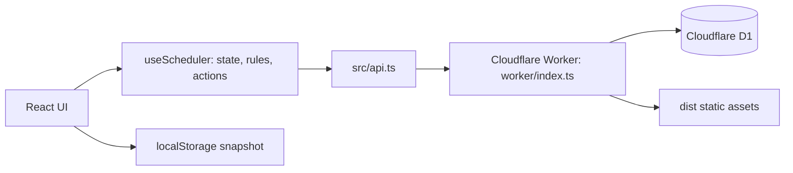

# UTAC QA Calendar (QMS-CASS) — คู่มือพัฒนาระบบภาษาไทย

เอกสารนี้สอนผู้พัฒนาคนใหม่ให้ตั้งค่าโปรเจกต์ เข้าใจการทำงานของแอป แก้ไขฟีเจอร์โดยรักษาการเชื่อมต่อระหว่างหน้าจอกับข้อมูล และเตรียมงานสำหรับตรวจสอบ/ส่งมอบให้ทีม IT

> **สภาพแวดล้อม:** คำสั่ง deploy และ migration ระยะไกลสามารถเปลี่ยนระบบ/ข้อมูลจริงได้ ให้ทำงานกับ local D1 ก่อน และทำ production change เฉพาะเมื่อได้รับอนุมัติจาก IT และเจ้าของข้อมูล QA

## สารบัญ

1. [ภาพรวมโครงสร้างระบบ](#1-ภาพรวมโครงสร้างระบบ)
2. [เตรียมเครื่องและรันแอปในเครื่อง](#2-เตรียมเครื่องและรันแอปในเครื่อง)
3. [แอปเริ่มทำงานและโหลดข้อมูลอย่างไร](#3-แอปเริ่มทำงานและโหลดข้อมูลอย่างไร)
4. [โครงสร้างข้อมูลและหน้าที่ไฟล์หลัก](#4-โครงสร้างข้อมูลและหน้าที่ไฟล์หลัก)
5. [การสร้างและบันทึกนัดหมายทำงานอย่างไร](#5-การสร้างและบันทึกนัดหมายทำงานอย่างไร)
6. [แนวทางเพิ่มหรือแก้ฟีเจอร์](#6-แนวทางเพิ่มหรือแก้ฟีเจอร์)
7. [กฎธุรกิจที่ควรเข้าใจก่อนแก้โค้ด](#7-กฎธุรกิจที่ควรเข้าใจก่อนแก้โค้ด)
8. [ตรวจงานในเครื่องก่อนส่งให้ตรวจสอบ](#8-ตรวจงานในเครื่องก่อนส่งให้ตรวจสอบ)
9. [วงจร migration และ release](#9-วงจร-migration-และ-release)
10. [แก้ปัญหาที่พบบ่อย](#10-แก้ปัญหาที่พบบ่อย)
11. [ประเด็นด้านความปลอดภัยและการส่งมอบ](#11-ประเด็นด้านความปลอดภัยและการส่งมอบ)
12. [แผนที่อ่านโค้ดตามงาน](#12-แผนที่อ่านโค้ดตามงาน)

---

## 1. ภาพรวมโครงสร้างระบบ

แอปเป็น SPA ที่ใช้ React และ TypeScript โดย Cloudflare Worker ทำหน้าที่เป็น API และให้บริการไฟล์หน้าเว็บที่ build แล้ว ส่วนข้อมูลร่วมเก็บใน Cloudflare D1 ซึ่งเป็น SQLite



ข้อควรจำ:

- `src/components/` แสดงหน้าจอและเรียก callback จาก ViewModel
- `src/useScheduler.ts` เป็นตัวกลางหลักของ state, navigation, filter, validation, mutation และ ViewModel (`VM`)
- `src/types.ts` เก็บ domain types, normalization, validation และกฎคำนวณสถานะ
- `src/api.ts` เป็น client สำหรับเรียก `/api/*`
- `worker/index.ts` ตรวจ session, จัดการ API routes และอ่าน/เขียน D1
- `migrations/` คือ SQL migration ตามลำดับเลข ห้ามแก้ไฟล์ migration ที่เคยนำไปใช้แล้ว ให้เพิ่มหมายเลขใหม่
- `wrangler.toml` กำหนดชื่อ Worker, static asset binding และ D1 binding

## 2. เตรียมเครื่องและรันแอปในเครื่อง

### 2.1 ติดตั้ง

ต้องใช้ Node.js และ npm ที่เข้ากันได้กับ dependencies ใน `package-lock.json` จาก root ของ repository:

```bash
npm ci
```

### 2.2 โหมด Vite อย่างเดียว

```bash
npm run dev
```

โหมดนี้เหมาะกับการแก้ layout/component อย่างรวดเร็ว ใช้การทำงานแบบพัฒนาในเบราว์เซอร์ และ **ไม่ได้รัน Cloudflare Worker หรือ D1** จึงไม่ใช่การตรวจยืนยัน API/authentication แบบ production

### 2.3 โหมด Worker พร้อม local D1

1. ตรวจ `wrangler.toml` ว่า binding ชี้ local dev ตามที่คาด อย่าเพิ่ม `--remote` โดยไม่จำเป็น
2. สร้าง/อัปเดตฐานข้อมูล local ด้วย migration:

   ```bash
   npm run migrate:local
   ```

3. หากทดสอบสมัครบัญชี Worker ให้สร้างไฟล์ `.dev.vars` ที่ root ซึ่งไม่ถูก commit:

   ```dotenv
   REGISTRATION_CODE=ใส่รหัสทดสอบเฉพาะเครื่อง
   ```

4. เริ่ม Worker dev server:

   ```bash
   npm run dev:worker
   ```

สคริปต์ `dev:worker` จะ build ก่อน แล้วสั่ง `wrangler dev`; Wrangler จะพิมพ์ URL/port ที่ใช้จริงใน terminal

> อย่าใส่ production registration code, Cloudflare token หรือข้อมูลลูกค้าจริงลง `.dev.vars`, source code, log หรือ screenshot ที่จะ commit

## 3. แอปเริ่มทำงานและโหลดข้อมูลอย่างไร

1. `src/main.tsx` mount `<App />` ลงใน `#root`
2. `src/App.tsx` เรียก `useScheduler()` แล้วเลือก render Login หรือแอปตาม `loading`, `showLogin`, `showApp` และ tab ปัจจุบัน
3. `initialState()` ใน `src/data.ts` โหลดค่าเริ่มต้นและ browser snapshot; เดือน/ปีเริ่มจากเวลาจริงผ่าน `getCurrentCalendarDefaults(new Date())`
4. `useScheduler()` ตรวจ `authClient.getSession()`; ใน Worker mode session จริงตรวจจาก HttpOnly cookie กับ D1
5. เมื่อ session ใช้ได้ จึงเรียก `api.fetchState()` (`GET /api/state`)
6. Worker อ่าน engineers, plants, orders, assignments, comments, activity, options และ holidays จาก D1 แล้วคืน JSON
7. Frontend normalize ข้อมูลก่อนใช้ (`normalizeAssignment`, `normalizeSite` ฯลฯ) และอัปเดต state/ViewModel
8. Browser snapshot ช่วยเปิดข้อมูลในฝั่ง client แต่ใน Worker mode เมื่อโหลด state สำเร็จ ข้อมูลจาก D1 เป็นแหล่งหลัก

เมื่อเปิดหน้าแล้วข้อมูลว่าง ให้ตรวจ URL/terminal ก่อนว่าใช้ Vite-only หรือ Worker+D1, ตรวจสถานะ sign-in และดู Network/Console ว่า `/api/auth/session` หรือ `/api/state` ตอบอะไร

## 4. โครงสร้างข้อมูลและหน้าที่ไฟล์หลัก

| ไฟล์/โฟลเดอร์ | ใช้ทำอะไร |
|---|---|
| `src/types.ts` | `Assignment`, `Order`, `Engineer`, `State`, `CreateDraft`, site normalization, required-field validation, audit status และ metric helpers |
| `src/data.ts` | default options, site palette, `initialState()` และปฏิทินค่าเริ่มต้น |
| `src/useScheduler.ts` | hook กลาง; state, action handlers, filters, derived ViewModel และ callback ที่ส่งให้ component |
| `src/api.ts` | API client และ type ของ API payloads |
| `src/utils/authClient.ts` | sign-in, session restore/logout, sign-up และเปลี่ยนรหัสผ่าน |
| `src/utils/auditOptionsHelper.ts` | คำนวณตัวเลือก dropdown จากข้อมูลนัดหมายและรายการไซต์หลัก |
| `src/holidays.ts` | กฎอ่าน holiday/restriction และผลกระทบต่อวันที่/ไซต์ |
| `src/components/Schedule.tsx` | ตารางปฏิทินและการ์ดนัดหมาย |
| `src/components/AppointmentFormFields.tsx` | ฟิลด์ร่วมของแบบฟอร์ม CS/IA |
| `src/components/CreateModal.tsx`, `EditModal.tsx` | wrapper สำหรับสร้าง/แก้ไข; ใช้ shared form fields |
| `src/components/TableView.tsx` | ค้นหา เรียง กรองและ export รายการ |
| `src/components/SummaryDashboard.tsx` | สรุป KPI และ export summary |
| `src/components/Admin.tsx` | Manage QMS Host, options และ holidays |
| `src/components/HistoryView.tsx` | activity/audit trail |
| `worker/index.ts` | auth endpoints, API routing, D1 SQL และ static asset fallback |
| `migrations/*.sql` | schema/data migration ที่ใช้กับ D1 |

แบบจำลองปัจจุบันเก็บนัดหมายรายวันใน `assignments`; รายการหลายวันเชื่อมกันด้วย `seriesId`/`groupId` และมีข้อมูล order/engineer ประกอบ การแก้ series จึงต้องตรวจกรณีหลายวันและการแบ่ง/ลบเฉพาะวันเสมอ

## 5. การสร้างและบันทึกนัดหมายทำงานอย่างไร

### สร้าง

1. ผู้ใช้เปิด `CreateModal`; ฟอร์มใช้ `AppointmentFormFields` และเก็บค่าชั่วคราวใน `createDraft`
2. `submitCreate()` ใน `src/useScheduler.ts` ตรวจว่ามีข้อมูลตั้งต้น, วันที่เริ่มไม่เกินวันสิ้นสุด และวัน/ไซต์ไม่ขัด holiday rules
3. ช่วงวันถูกขยายเป็น assignment ราย weekday ที่ใช้ได้; `seriesId`/`groupId` ระบุว่าแถวเหล่านี้เป็นชุดเดียวกัน
4. สร้าง/ค้นหา QMS Host record ที่จำเป็น และประกอบ `Assignment`/`Order` ตามชนิด CS หรือ IA
5. UI อัปเดต state แบบ optimistic เพื่อแสดงผลทันที แล้วเรียก API create assignment/order/engineer ตามข้อมูลที่ต้องเพิ่ม
6. Worker ใช้ prepared SQL กับ D1; ถ้าบันทึกไม่ได้ `reportSaveFailure()` แสดงแถบ error เพื่อไม่ให้ผู้ใช้เข้าใจว่าข้อมูลถูกบันทึกสำเร็จ

### แก้ไข/ลบ

- `submitEdit()` ตรวจวันที่, holiday rule และ shutdown sites แล้วปรับ assignment ที่เกี่ยวข้อง
- เมื่อเป็น multi-day ให้รักษาความสัมพันธ์ของ series และรองรับการแก้เฉพาะวันหรือทั้งชุด
- `removeAssign()` ลบวันเดียวหรือทั้งรายการตาม scope ที่ขอ; ตรวจความสัมพันธ์ comments/orders ก่อนเพิ่มการลบ
- ผลตรวจต่อไซต์อยู่ใน `results` และถูก normalize ด้วย `normalizeAuditResults()`
- ปรับข้อมูลที่ต้องใช้หลายหน้าจอที่ชั้น domain/API ไม่ควรแก้แค่ข้อความหรือสีใน component เดียว

## 6. แนวทางเพิ่มหรือแก้ฟีเจอร์

### 6.1 ปรับหน้าจอที่มีอยู่

1. ระบุหน้าจอและ component ที่ render ฟีเจอร์จาก `src/App.tsx`
2. ตรวจว่า component รับ props จาก `VM` อะไร และ callback นั้นถูกประกาศ/ส่งใน return object ของ `useScheduler()` ตรงไหน
3. แก้ component สำหรับ markup/interaction; แก้ state/action ที่ hook; แก้กฎร่วมไว้ใน helper/domain layer
4. ตรวจ desktop และ layout แคบ, loading/empty/error states, keyboard/focus และ cursor

### 6.2 เพิ่ม field ใหม่ในนัดหมาย

ทำเป็นแนวตั้งครบทั้ง flow:

1. เพิ่ม field และความหมายใน `Assignment`/`CreateDraft`/`EditDraft` ที่ `src/types.ts`
2. เพิ่มค่า default และ hydration ที่ `src/data.ts`/`useScheduler.ts`
3. เพิ่ม field/control ใน `AppointmentFormFields.tsx`; ตรวจทั้ง CS และ IA รวมถึง create และ edit
4. เพิ่ม validation/normalization ใน shared domain helper; ระบุว่าบังคับหรือไม่และสถานะ incomplete ต้องเปลี่ยนอย่างไร
5. เพิ่ม serialization/deserialization ใน `src/api.ts` และ `worker/index.ts`
6. เพิ่ม SQL migration ใหม่ `migrations/0020_...sql` (ใช้หมายเลขถัดจาก migration ล่าสุดจริง), ทดสอบ migration กับ local D1 และข้อมูลเดิม
7. ต่อ field ไปยัง card/detail, filters, Table, Summary/export และ History ตามที่ field นั้นมีผล
8. อัปเดตคู่มือผู้ใช้และคู่มือ developer หาก workflow หรือ data contract เปลี่ยน

**อย่า** เพิ่ม field ในฟอร์มแล้วลืม API/DB; อย่าแก้ migration เก่าที่อาจถูกใช้ใน D1 ไปแล้ว; อย่าทำให้ข้อมูลเก่าที่ field ว่างอ่านไม่ได้

### 6.3 เพิ่ม API endpoint

1. กำหนด request/response type ก่อน แล้วเพิ่ม client method ใน `src/api.ts`
2. เพิ่ม route ใน `handleApi()` ใน `worker/index.ts` โดยตรวจ method, payload, ownership/authorization และผลลัพธ์ผิดพลาด
3. ใช้ `DB.prepare(...).bind(...)` สำหรับค่าที่มาจาก request ห้ามต่อ string SQL ด้วยค่าผู้ใช้
4. ตรวจ session และ policy: API ปัจจุบันต้องมี session สำหรับ routes ที่ไม่ใช่ public auth; บทบาท `admin` ยังไม่ถูกบังคับเป็น authorization boundary ดู [IT Handover](./HANDOVER.md)
5. ถ้าต้องเพิ่ม/แก้ schema ให้ทำ migration ใหม่และทดสอบ local ก่อน

### 6.4 ปรับสถานะหรือสีของการ์ด

- กฎตัดสินสถานะอยู่ที่ `resolveAuditStatus()` และ `STATUS_COLOR_MAP` ใน `src/types.ts`
- สีพื้น/ขอบการ์ดส่วนกลางอยู่ใน `getApptCardColors()` ใน `src/useScheduler.ts`
- สีแถบด้านซ้ายของการ์ดมาจาก site color; อย่าใช้ status color แทน site code
- ตรวจ legend, Schedule, Table, mobile/compact cards และคู่มือเอกสารให้สอดคล้อง

### 6.5 ปรับ holiday/restriction

ตรวจทั้งการแสดงผลใน Manage, helper ใน `src/holidays.ts`, validation ที่ `submitCreate()`/`submitEdit()` และ API/ตาราง `custom_holidays` ใน Worker/D1 การแก้สี cell อย่างเดียวไม่เพียงพอ เพราะกฎนี้มีผลว่าผู้ใช้จอง CS/IA และไซต์ใดได้หรือไม่

### 6.6 เปลี่ยน Excel export

ตัว export อยู่ใน `TableView.tsx` และ `SummaryDashboard.tsx` โดยโหลด Excel package แบบ lazy import ตรวจว่าการ export ใช้ **filter ปัจจุบัน**, ช่วงปี, จำนวน site และลำดับคอลัมน์/summary ให้ตรง UI แล้วลองเปิดไฟล์ที่ export ได้จริง

## 7. กฎธุรกิจที่ควรเข้าใจก่อนแก้โค้ด

- ไซต์หลักมี 7 ค่า: `UTL1`, `UTL2`, `UTL2A`, `UTL2B`, `UTL3`, `UTL3A`, `UTL3T`; ใช้ `normalizeSite()`/`normalizeSites()` เพื่อรองรับข้อมูล legacy
- CS กับ IA มี required fields คนละชุด; ดู `isAppointmentFormIncomplete()` และ `getMissingFields()` ที่ `src/types.ts` ก่อนเปลี่ยน validation
- หลายวันไม่ใช่แถวเดียวเสมอ; แถวในช่วงวันเดียวกันเชื่อมกันด้วย series/group identifiers
- สถานะหลัก: Incomplete = แดง, New = ม่วง, Updated = น้ำเงิน, Pending Result = เหลือง/อำพัน, Complete = เขียว; พื้นการ์ดเป็น tint ส่วน site strip แสดงไซต์
- Priority สถานะและกรอบเวลาอยู่ใน `resolveAuditStatus()`; ใช้ helper นี้แทนการเขียนเงื่อนไขสีซ้ำใน component
- `Public Holiday` ปิด CS และ IA; `No Customer Audits` ปิด CS แต่เปิด IA; `Shutdown Plant` ปิด CS และล็อก IA เฉพาะไซต์ที่กำหนด
- dropdown หลายค่าบางฟิลด์ใช้ ` / ` ในการเก็บ/แสดง; รักษา compatibility กับข้อมูลเดิมที่เป็นค่าเดียว
- หลังโหลด server state สำเร็จ D1 เป็น source of truth; snapshot ใน localStorage เป็น cache ไม่ใช่หลักฐานว่าการเขียนลง D1 สำเร็จ

## 8. ตรวจงานในเครื่องก่อนส่งให้ตรวจสอบ

ใน package ปัจจุบันมีคำสั่ง lint และ build แต่ไม่มี `test` script:

```bash
npm run lint
npm run build
```

จากนั้นทดสอบ manual บน local Worker+D1 ตามพื้นที่ที่แก้:

- Login, refresh, logout และ session behavior ถ้าแตะ auth
- สร้าง/แก้/ลบ Customer Audit และ Internal Audit
- ฟิลด์ที่จำเป็น, incomplete draft, หลายวัน, และ holiday/restriction
- QMS Host, filters, Schedule/Table consistency, Summary, History และ export ตามขอบเขตที่กระทบ
- เปิด DevTools Network/Console ตรวจว่า API สำเร็จและไม่มี error; ตรวจใน local D1 ว่าข้อมูลยังอยู่หลัง reload

ก่อนส่ง PR/change ให้ระบุไฟล์ที่เปลี่ยน, business rule ที่ได้รับผล, migration ใหม่ (ถ้ามี), วิธีตรวจ, และความเสี่ยง/จุดที่ต้องอนุมัติ อย่าแนบ secret หรือ production customer data

## 9. วงจร migration และ release

### Migration

1. ใช้หมายเลขต่อจาก `migrations/` ล่าสุดที่ commit แล้ว และตั้งชื่อให้สื่อความหมาย
2. เขียน migration แบบ SQL ที่รองรับข้อมูลเก่า และพิจารณาว่าการเปลี่ยนย้อนกลับได้หรือไม่
3. ใช้ `npm run migrate:local` กับ local D1; ตรวจ `npm run dev:worker`, CRUD และการอ่านข้อมูลก่อน/หลัง migration
4. ส่ง migration ให้ code review และให้ QA/Data Owner อนุมัติ
5. production ใช้ `npm run migrate:remote` ซึ่งแก้ D1 ที่กำหนดใน `wrangler.toml`; ทำเฉพาะตาม IT change window และ runbook ใน [HANDOVER](./HANDOVER.md)

### Release

1. review diff และ merge เฉพาะ branch/commit ที่ได้รับอนุมัติ
2. lint, build และ manual smoke test ใน local Worker+D1
3. แยกการ apply migration ออกจาก code deploy และตรวจ migration status ก่อนทำ
4. IT operator รัน `npm run deploy` หลังยืนยัน Cloudflare account/Worker target
5. ตรวจ Worker logs, login, `/api/state`, save flow และ export หลัง deploy; บันทึก commit/version/ผลตรวจ
6. หากมีปัญหา หยุดการเปลี่ยนข้อมูลและทำตาม rollback/recovery workflow แยก Worker version กับ D1 ตาม handover

Repository ปัจจุบันไม่มี staging environment ที่ประกาศใน `wrangler.toml`. ห้ามสมมติว่าการทดสอบ local เป็น staging และห้ามใช้ production D1 เพื่อทดสอบ

## 10. แก้ปัญหาที่พบบ่อย

| อาการ | ตรวจ/แก้ไข |
|---|---|
| หน้าจอเปิดแต่ข้อมูลไม่ตรง/ไม่มีรายการ | ตรวจว่า `npm run dev` หรือ `npm run dev:worker`; Vite-only ไม่เรียก Worker/D1 แบบเดียวกับ production |
| Login ได้แต่ API 401 | ตรวจ session cookie, URL origin, เวลาหมดอายุและว่า Worker/API ใช้ origin เดียวกัน |
| กด Save แล้วข้อมูลหายหลัง reload | ตรวจ save warning, Network response, Worker logs และ local D1; optimistic UI ไม่ได้แปลว่า D1 write สำเร็จ |
| dropdown ไม่มีตัวเลือกหรือมีรายการเก่า | ตรวจ dynamic options helper และนัดหมายที่ยังใช้ค่านั้น; localStorage snapshot ไม่ใช่ข้อมูลหลักเมื่อ API fetch สำเร็จ |
| TypeScript build ผ่านไม่ได้ | อ่าน diagnostic แรกจาก `npm run build`; ตรวจ domain types, `VM` inference และ API payload ให้ตรงกัน |
| migration ใช้ซ้ำไม่ได้ | ตรวจ schema ของ local D1 และ migration history; อย่าแก้ migration ที่ apply ไปแล้ว ให้เพิ่ม migration ใหม่ |
| Worker เสิร์ฟ API แต่เปิดหน้าไม่ได้ | ตรวจ `npm run build`, `dist/`, `[assets] directory` และ `ASSETS` binding ใน Wrangler config |

## 11. ประเด็นด้านความปลอดภัยและการส่งมอบ

ก่อนขยายระบบให้ผู้ใช้จริง อ่านข้อค้นพบใน [IT Engineering Handover](./HANDOVER.md) ให้ครบ โดยเฉพาะ:

- role `admin`/`user` ยังไม่ใช่การจำกัดสิทธิ์ฝั่ง Worker; อย่าสมมติว่า Manage API เป็น admin-only
- `calendar_qa_snapshot` มีข้อมูลตารางใน browser localStorage และไม่ถูกลบเมื่อ sign-out ตามโค้ดปัจจุบัน
- การลงทะเบียนใช้ shared `REGISTRATION_CODE`; password/session implementation ต้องผ่านการทบทวน IT Security
- อย่า log credential, cookie, session token, registration code หรือข้อมูลลูกค้าที่ไม่จำเป็น
- Production binding, domain, secret presence และ deployment owner ต้องยืนยันใน Cloudflare/GitHub ของบริษัท; ค่าใน repo เพียงอย่างเดียวไม่ยืนยันสถานะ production

## 12. แผนที่อ่านโค้ดตามงาน

| ต้องการเข้าใจ/แก้ | เริ่มอ่าน |
|---|---|
| วิธี render ทั้งแอปและ navigation | `src/App.tsx`, `src/components/Header.tsx` |
| สถานะเริ่มต้น, login และ hydrate ข้อมูล | `src/data.ts`, `src/useScheduler.ts`, `src/utils/authClient.ts` |
| สร้าง/แก้/ลบ appointment | `src/components/AppointmentFormFields.tsx`, `CreateModal.tsx`, `EditModal.tsx`, `src/useScheduler.ts`, `src/api.ts`, `worker/index.ts` |
| holiday rules | `src/holidays.ts`, `src/components/Admin.tsx`, `src/useScheduler.ts`, `worker/index.ts` |
| status card colors/site strips | `src/types.ts`, `src/useScheduler.ts`, `src/components/Schedule.tsx`, `src/components/TableView.tsx` |
| Excel export | `src/components/TableView.tsx`, `src/components/SummaryDashboard.tsx` |
| D1 schema | `migrations/` ตามลำดับ migration |
| production operation | [IT Engineering Handover](./HANDOVER.md) |

## เอกสารที่เกี่ยวข้อง

- [คู่มือนักพัฒนาแบบ HTML พร้อมภาพ](./Developer-workflows.html)
- [คู่มือผู้ใช้ภาษาไทย/อังกฤษ](./User-manual.md)
- [Workflow ผู้ใช้ภาษาไทย](./User-workflows.md)
- [IT Engineering Handover](./HANDOVER.md)
- [ดัชนีเอกสาร](./index.md)
