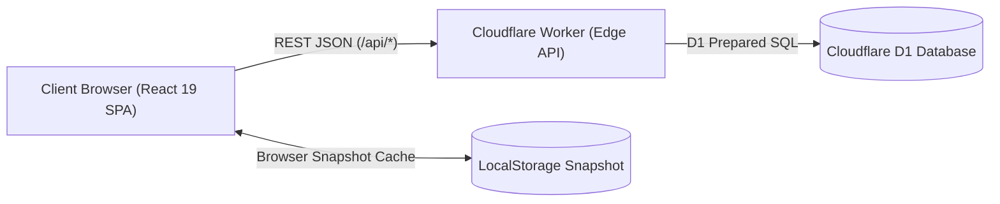
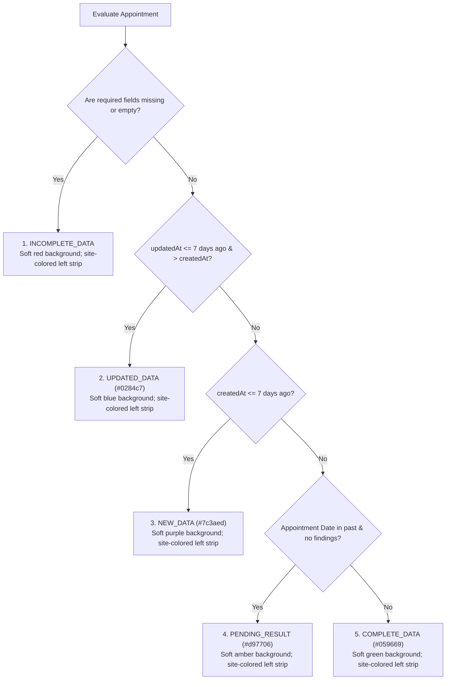

# UTAC QA Calendar (QMS-CASS) — Engineering and IT Handover

> **Document purpose**: Engineering and operations transfer to UTAC IT. **Reviewed against repository**: November 27, 2026.
> **Deployment status**: Not verified from this repository. Confirm the live Cloudflare account, Worker URL, active version, and database before treating this as a production runbook.
> **Primary technology stack**: React 19, TypeScript, Vite, Cloudflare Workers, Cloudflare D1 (SQLite), static assets.

---

## 1. Executive Summary & Purpose

The **UTAC QA Calendar (QMS-CASS)** is a scheduling and record-keeping application for Quality Assurance (QA) across UTAC's seven sites (**UTL1**, **UTL2**, **UTL2A**, **UTL2B**, **UTL3**, **UTL3A**, **UTL3T**). This document describes the code and configuration in this repository; the company IT team must verify the deployed account and production settings during takeover.

It replaces legacy spreadsheets with a real-time, multi-user scheduling workspace supporting:
- **Customer Audits (CS)** and **Internal Audits (IA)** scheduling with strict conflict and double-booking guardrails.
- **5-Tier Status Color System** synchronized across all views (Red, Purple, Blue, Yellow, Green).
- **Executive Summary Dashboard** with monthly matrix totals, canonical plant site sequences, and custom Excel exports.
- **High-Performance Multi-Filter Table View** with Excel export.
- **Auditor & Engineer Resource Management** with drag-and-drop sort orders and QA / Non-QA department segregation.
- **Serverless Cloudflare Worker Architecture** backed by Cloudflare D1 (SQLite) and client-side high-performance Excel (.xlsx) export engine.



---

## 2. Architecture & File Structure

```
Calendar-QA/
├── docs/                               # Documentation & Assets
│   ├── app-architecture-and-features.html    # Full English Architectural Blueprint
│   ├── app-architecture-and-features-th.html # Full Thai Architectural Blueprint
│   ├── index.html                            # Mirrored Web Entry
│   ├── images/                               # Hi-DPI Documentation Screenshots
│   └── HANDOVER.md                           # IT operations and engineering handover
├── images/                             # Public Root Screenshot Assets
├── migrations/                         # Cloudflare D1 Database SQL Migrations
│   ├── 0001_init.sql                         # Tables: plants, engineers, orders, assignments, etc.
│   ├── 0002_assignment_purpose.sql          # Appointment purpose column
│   ├── 0003_options.sql                     # Options & category metadata table
│   ├── 0004_target_package_customer_name.sql# Target package and customer names
│   ├── 0005_audit_category.sql               # Audit category field
│   ├── 0006_assignment_results.sql          # Quantitative findings (Major, Minor, OFI, Obs)
│   ├── 0007_assignment_timestamps.sql       # createdAt & updatedAt ISO timestamps
│   ├── 0008_standardize_utl_sites.sql       # Canonical UTL1..UTL3T normalization
│   ├── 0009_users.sql                       # User credentials and authentication store
│   ├── 0010_custom_holidays.sql .. 0017_*   # Holidays, metadata, results, and schema cleanup
│   ├── 0018_sessions.sql                    # Server session store
│   └── 0019_remove_demo_users.sql           # Removes legacy demo accounts
├── public/                             # Static Web Assets (utac-logo.jpg)
├── src/                                # Frontend Application Code
│   ├── components/                     # View & Modal Components
│   │   ├── Admin.tsx                         # Manage Page (Auditor roster, options drag-drop)
│   │   ├── AppointmentFormFields.tsx         # Shared form fields for create/edit
│   │   ├── AuditResultsModal.tsx             # Record quantitative findings (Major, Minor, OFI, Obs)
│   │   ├── AvailabilityDatePicker.tsx        # Multi-month visual day picker with conflict check
│   │   ├── CreateModal.tsx                   # Appointment creation dialog
│   │   ├── EditModal.tsx                     # Single-day / Series editing dialog
│   │   ├── EditScopeModal.tsx                # Multi-day split scope prompt
│   │   ├── EngineerModal.tsx                 # Create/Edit auditor & engineer profiles
│   │   ├── Header.tsx                        # Global header, nav switcher, and live presence
│   │   ├── HistoryView.tsx                   # Chronological audit trail of all changes
│   │   ├── Login.tsx                         # Sign in, staff-code registration, password change
│   │   ├── MultiAuditorSelect.tsx            # Multi-host tag combobox selector
│   │   ├── MultiSiteSelect.tsx               # Plant site selector supporting slash unions
│   │   ├── MultiStandardSelect.tsx           # Audit standard multi-tag selector
│   │   ├── Profile.tsx                       # Current user profile and credentials info
│   │   ├── Schedule.tsx                      # Core Calendar Grid (Week, Month, Year views)
│   │   ├── SummaryDashboard.tsx              # Executive Annual KPI matrix & Excel export
│   │   └── TableView.tsx                     # High-density searchable table with column filters
│   ├── utils/                          # Specialized Helper Libraries
│   │   ├── auditOptionsHelper.ts             # Dynamic option derivation from active appointments
│   │   └── authClient.ts                     # Server session client; local fallback is development-only
│   ├── api.ts                          # Same-origin API client using HttpOnly session cookies
│   ├── App.tsx                         # Root Application View Router
│   ├── data.ts                         # Initial state, default plants, and palette constants
│   ├── holidays.ts                     # UTAC official holidays and month-end lockouts
│   ├── index.css                       # Global CSS
│   ├── main.tsx                        # React 19 DOM entry mount
│   ├── types.ts                        # Core TypeScript Interfaces & Business Metrics Engine
│   ├── ui.tsx                          # Atomic CSS helper & base button primitives
│   └── useScheduler.ts                 # Master Hook (Reactive state, validation, CRUD, sync)
├── worker/                             # Cloudflare Worker Backend
│   └── index.ts                        # REST API routing, session validation, D1 query executor
├── package.json                        # Dependencies & NPM build scripts
├── tsconfig.json                       # TypeScript compiler configurations
├── vite.config.ts                      # Vite build configuration with React plugin
└── wrangler.toml                       # Cloudflare Workers & D1 configuration binding
```

---


### 2.1 End-to-End System & Data Workflows

#### 🔄 Workflow A: Data Loading & State Hydration
1. **Browser Snapshot Load (`src/data.ts` &rarr; `initialState()`)**: Reads the cached snapshot into memory. In production, the app waits for server session validation before showing shared schedule data.
2. **Session Check (`src/useScheduler.ts` &rarr; `/api/auth/session`)**: Restores a server-verified HttpOnly-cookie session before opening the shared scheduler.
3. **Edge API Handshake (`src/useScheduler.ts` &rarr; `api.fetchState()`)**: After session validation, dispatches `GET /api/state` to Cloudflare Worker; D1 replaces stale browser snapshots.
4. **Concurrent D1 Queries (`worker/index.ts`)**: Worker executes parallel queries for engineers, plants, active plants, orders, assignments, comments, activity, options, and holidays.
5. **State Hydration & Snapshot Update (`src/useScheduler.ts`)**: Normalizes authenticated server records via `normalizeAssignment()` and stores a browser snapshot for faster development startup.
6. **Unified Metrics Rollup (`src/utils/auditMetricsHelper.ts` &rarr; `calculateAuditStats()`)**: Groups consecutive-day appointment slots into unified campaigns, producing identical metrics (`customerAudits`, `internalAudits`, `totalAudits`) across all views.

#### ⚡ Workflow B: Create / Update / Delete Mutation Flow
1. **User Form Submission (`AppointmentFormFields.tsx`)**: Incomplete-state validation checks 8 Customer Audit fields or 5 Internal Audit core fields, plus the date range.
2. **Optimistic ViewModel Update (`src/useScheduler.ts`)**: Handlers (`submitCreate()`, `submitEdit()`, `removeAssign()`) mutate `state.assignments` in memory with zero perceptible latency and refresh the `localStorage` snapshot.
3. **Asynchronous REST API Invocation (`src/api.ts`)**: Dispatches background API calls:
   - Create: `POST /api/assignments`, `POST /api/orders`
   - Edit: `PUT /api/assignments/:id`
   - Delete: `DELETE /api/assignments/:id` (with cascading comments deletion)
4. **D1 Persistence (`worker/index.ts`)**: Worker executes parameterized SQL (`INSERT`, `UPDATE`, `DELETE`) on Cloudflare D1. Failed writes show a warning; after reload, the authenticated D1 state is authoritative.
5. **Dynamic Dropdown Options Refresh (`src/utils/auditOptionsHelper.ts` &rarr; `getActiveDropdownOptions()`)**: Autocomplete options for `STANDARD`, `CUSTOMER`, `PURPOSE`, `QMS HOST`, etc., are re-derived reactively from active schedule records. Deleted values disappear immediately across Modal, Table, and Manage views, while `SITE` preserves the fixed `MASTER_PLANT_SITES` list (`UTL1`..`UTL3T`).

#### 📊 Workflow C: Client-Side Excel (.xlsx) Export Flow
1. **Trigger Export**: Initiated from `TableView.tsx` (`handleExportExcel`) or `SummaryDashboard.tsx` (`handleExportVisitsExcel`, `handleExportFindingsExcel`).
2. **Data Extraction & KPI Rollup**: Pulls active filtered rows or structured Site &times; Month matrices generated by `calculateAuditStats()`.
3. **On-Demand Lazy Loading**: Dynamically imports `xlsx-js-style` (`await import('xlsx-js-style')`) without increasing the initial bundle size.
4. **In-Memory Worksheet Construction & Styling**: Converts data via `XLSX.utils.aoa_to_sheet()`, injecting cell styles (Calibri, header fills, double borders for totals, auto column widths, and AutoFilter).
5. **Instant Browser File Download**: Calls `XLSX.writeFile(workbook, filename)` to download the `.xlsx` file directly in browser memory (100% client-side, 0 server requests, 0 third-party cloud dependencies).

---

## 3. Core Business Logic & Algorithms

### 3.1 5-Tier Status Color System
Schedule cards and the sidebar legend use the status mapping in `src/types.ts`. Card fills are soft status tints; the left accent strip identifies the site:



> [!IMPORTANT]
> **Priority Rule for Recent Edits**:
> A complete appointment edited within the last 7 days displays **Blue** when `updatedAt` is later than `createdAt`, even if it was created within the last 7 days. Otherwise, a newly created appointment displays **Purple**, including future or backdated appointments.

---

### 3.2 Unified Audit Counting & Grouping
Audit metrics are shared across Schedule, Table, and Summary views via [`calculateUnifiedAuditMetrics`](../src/types.ts#L886-L1010):
- **Grouping Rule**: Consecutive calendar days (ignoring weekends) belonging to the **SAME Customer**, **SAME Plant Site**, and **SAME Audit Purpose** are grouped as **1 single audit visit**.
- **Different Purpose / Site Separation**: If Customer "Apple" has an audit at `UTL1` for "Annual Audit" and simultaneously at `UTL2` for "System Audit", they count as **2 separate audits**.

---

### 3.3 Dynamic Dropdown Option Derivation
Implemented in [`src/utils/auditOptionsHelper.ts`](../src/utils/auditOptionsHelper.ts):
- **Dynamic Fields**: `STANDARD`, `CUSTOMER`, `END CUSTOMER`, `PURPOSE`, `TARGET PACKAGE`, `CUSTOMER NAME`, `QMS HOST`, `AUDIT CATEGORY`, and `AREA` derive their dropdown suggestions strictly from currently scheduled appointments.
- **Auto-Pruning on Deletion**: When an appointment is deleted, any value exclusively used by that appointment immediately disappears from all dropdowns, and any active filters selecting that value are automatically cleared.
- **Exception for `SITE`**: The `SITE` dropdown (`Select site...`) always displays the static master list of plant sites (`MASTER_PLANT_SITES`: `UTL1`, `UTL2`, `UTL2A`, `UTL2B`, `UTL3`, `UTL3A`, `UTL3T`), even when zero appointments are scheduled for a site.

---

### 3.4 Subtitle Rendering (`formatCardSubtitle`)
Located in [`src/types.ts`](../src/types.ts#L615-L635):
1. **Both Purpose and Host exist**: Displays `"${purpose} - ${host}"` (e.g. `"Annual Audit - Viroj, Marc"`).
2. **Purpose is empty, Host exists**: Displays ONLY `"${host}"` (e.g. `"Viroj, Marc"`), preventing duplicate strings.
3. **Purpose exists, Host is empty**: Displays ONLY `"${purpose}"`.
4. **Both are empty**: Displays `"Unassigned"`.

---

## 4. Development & Operation Guide

### 4.1 Prerequisites
- **Node.js**: v20.x or higher (tested on Node v24.18.0)
- **NPM**: v10.x or higher
- **Cloudflare Wrangler CLI**: (included in devDependencies)

### 4.2 Installation
```bash
npm install
```

### 4.3 Available Scripts
| Command | Purpose |
| :--- | :--- |
| `npm run dev` | Starts local Vite development server on `http://localhost:5173` |
| `npm run dev:worker` | Builds the frontend and starts local Cloudflare Worker with local D1 database |
| `npm run build` | Compiles TypeScript (`tsc -b`) and bundles production assets via Vite |
| `npm run lint` | Runs `oxlint` high-speed linter across all TypeScript files |
| `npm run preview` | Previews local production build |
| `npm run migrate:local` | Applies database SQL migrations to local Cloudflare D1 database |
| `npm run migrate:remote` | Applies database SQL migrations to live production Cloudflare D1 database |
| `npm run deploy` | Builds and deploys the full-stack application to Cloudflare Workers |

---

## 5. Security & Authentication Architecture

Authentication is managed via `src/utils/authClient.ts` and `worker/index.ts`:
- **User Identification**: User ID (letters, numbers, dots, underscores, and dashes).
- **Password Verification**: The Worker verifies the password against a salted SHA-256 hash stored in D1.
- **Server Sessions**: Migration `0018_sessions.sql` adds the session store. Successful sign-in creates a random token stored only as a hash in D1 and sent to the browser in an HttpOnly, SameSite=Lax cookie. All scheduler API routes require a valid session.
- **Session Duration**: Regular sessions expire server-side after 12 hours. “Remember me” sessions last up to 30 days. Signing out revokes the server session.
- **Registration Gate**: Sign-up requires the Worker secret `REGISTRATION_CODE`. Migration 0019 removes known demo accounts and promotes the earliest remaining account if none is admin. On an empty database, the first registered account receives `admin`; later accounts receive `user`.
- **Password Changes**: The current password is required; a successful change revokes all sessions for that account.
- **Development Fallback**: `npm run dev` without a Worker uses a browser-local account store; create a local account through Sign Up. This fallback is disabled in production builds and is not server access control.
- **Legacy Demo Users**: Migration `0019_remove_demo_users.sql` removes the previously documented shared-password accounts. Apply migrations before deployment.

To configure registration, an authorized Worker operator runs `npx wrangler secret put REGISTRATION_CODE`. For `npm run dev:worker`, put a local value in the untracked `.dev.vars` file. Never commit registration secrets. Production secret presence/value and Cloudflare account configuration are not verifiable from this repository.

### Important application access and data-protection findings for IT

- **The `admin` / `user` role is not currently an authorization boundary.** The header displays a role label, but the navigation exposes Manage to signed-in users and the Worker checks for a valid session rather than enforcing admin-only authorization on management API routes. Do not assume that `user` accounts are read-only. Before broad production use, IT and the QA product owner should decide whether to add and test server-side role checks.
- **Registration is gated by one shared `REGISTRATION_CODE`.** In the Worker, the first account in an empty users table is assigned `admin`; later registrations are assigned `user`. The Worker also promotes the earliest account if none is admin. There is no account administration screen for safely creating more admins or disabling/leaver accounts. Agree on an account lifecycle and code-rotation process before enabling sign-up for staff.
- **Password handling needs a security review.** The current Worker hashes passwords with salted SHA-256 and accepts passwords of at least four characters. The repository does not configure enterprise SSO or MFA. UTAC IT Security should approve this design or require a stronger password hashing and identity setup before production onboarding.
- **Browser cache contains business data.** `calendar_qa_snapshot` in browser `localStorage` includes appointment, customer, QMS Host, comments, and related schedule data. Signing out removes the saved user profile and revokes the server session, but does not remove that schedule snapshot. Apply company managed-device/browser policies and decide whether the app should clear or minimize this cache on sign-out. Do not use shared/public devices for sensitive records until this is addressed.
- **The remembered UI profile is not the server session.** The server session lasts 12 hours without Remember me or 30 days with Remember me; these values are in `worker/index.ts`. API access still depends on the valid HttpOnly cookie and the D1 session. A persisted browser profile does not extend an expired server session.

---

## 6. Cloud Integrations & Background Sync

### 6.1 Excel (.xlsx) Spreadsheet Export Engine
Export utilities in [`SummaryDashboard.tsx`](../src/components/SummaryDashboard.tsx) and [`TableView.tsx`](../src/components/TableView.tsx) use `xlsx` and `xlsx-js-style`:
- **Audit Appointments Table**: Exports full 7-column filtered schedule with custom styling.
- **Audit Findings by Site**: Multi-format dropdown menu supporting:
  1. *Full Matrix*: Cross-tabulated site matrix with Major, Minor, OFI, Obs breakdown.
  2. *Summary*: Compact site distribution rollup.
  3. *Single Site Filtered*: Individual facility reports (`UTL1`, `UTL2`, etc.).

---

## 7. Operational Troubleshooting & FAQs

### Q1: The dev server starts, but appointments show 0
> **Cause**: Vite standalone mode (`npm run dev`) does not run the Cloudflare Worker API backend on port 5173.  
> **Fix**: Either run `npm run dev:worker` to start full-stack Worker + local D1, or use the app UI to create an appointment (which automatically seeds `localStorage` snapshot).

### Q2: A deleted customer or auditor still appears in the dropdown
> **Cause**: An appointment still exists somewhere in the schedule using that value (e.g. Incomplete Appointments or in a different month).  
> **Fix**: Check Table View (`TableView.tsx`) and filter by that name. Once the appointment is edited or deleted, the helper [`getActiveDropdownOptions`](../src/utils/auditOptionsHelper.ts) will immediately purge it from all suggestions.

### Q3: How to add a new manufacturing site (e.g. UTL4)?
> 1. Add `UTL4` to `MASTER_PLANT_SITES` in [`src/utils/auditOptionsHelper.ts`](../src/utils/auditOptionsHelper.ts).
> 2. Add `UTL4` color token to `initialSiteColors` in [`src/data.ts`](../src/data.ts).
> 3. Add `UTL4` column to `CANONICAL_SITE_ORDER` in [`src/components/SummaryDashboard.tsx`](../src/components/SummaryDashboard.tsx).
> 4. Run `npm run build` to verify compilation.

---

## 8. Local Development and Production Boundaries

`npm run dev` starts Vite without the Cloudflare Worker; it uses browser-local development authentication/data and is not representative of production access control. `npm run dev:worker` builds the app and starts the Worker with local D1. Use a non-production environment for development and test data only. The repository declares no named staging environment; do not point local development at production D1.

The checked-in configuration contains a Worker name and D1 database ID, but it does not establish which Cloudflare account owns them, what hostname is live, whether a Git-based build is configured, or what code version is deployed. IT must verify these items in company-owned accounts before making operational changes.

---

## 9. IT Ownership and Responsibility Transfer

The following ownership split is proposed. Replace role names with named owners and escalation contacts during formal handover.

| Work area | Proposed accountable owner | Ongoing responsibility |
| :--- | :--- | :--- |
| Cloudflare account and Worker | UTAC IT Cloud / Platform Operations | Account ownership, least-privilege access, Worker settings, deployment control, domain/route and account recovery |
| D1 and data protection | UTAC IT Data/Platform Operations with QA data owner | Migration approval, backup/restore policy, access, retention, recovery exercises, and data export decisions |
| QA process and data quality | QA/QMS process owner | Audit definitions, required fields, status use, QMS Host roster, holiday rules, and user acceptance |
| Source code and releases | Named IT application maintainer with QA change approver | Repository access, code review, build/release process, change log, defect triage, and maintenance |
| Identity and security | UTAC IT Identity/Security | Registration policy, admin lifecycle, authentication review, incident response, and any required SSO/MFA/RBAC work |

### Repository facts to verify in Cloudflare and GitHub

- Wrangler project name: `utac-qa-calendar`.
- Worker entry point: `worker/index.ts`; static assets are served from `dist/` through the `ASSETS` binding.
- D1 binding: `DB`; configured database name: `calendar-qa-db`; configured database ID: `11c524c4-b02e-4d38-840e-ee98294f2118` in `wrangler.toml`.
- Compatibility date: `2025-04-01`.
- No staging environment, custom domain, Cloudflare account ID, CI/CD workflow, or monitoring alert configuration is declared in this repository. This does not prove none exists in the dashboards; IT must verify.
- `origin` is a GitHub remote. Repository config alone does not confirm who owns it or whether Cloudflare builds from GitHub.

### Takeover checklist

1. Assign a Cloudflare account owner and at least two company-controlled administrators; remove individual-only ownership and review user/token access.
2. Confirm the production Worker, URL/custom domain, D1 database ID, deployed version, Cloudflare account, and GitHub repository ownership in the dashboards. Record them in the company CMDB or approved service register, not in a public document.
3. Confirm whether `REGISTRATION_CODE` exists, who can rotate it, and whether self-registration is allowed. Never put its value in tickets, Git, or this document.
4. Create IT-maintained secrets/API access and local development instructions; do not reuse a developer's personal Cloudflare credentials.
5. Review the access, password, localStorage, SSO/MFA, and account lifecycle findings in Section 5 with Security and the QA data owner. Assign remediation owners and decisions.
6. Define a release approver, rollback decision-maker, support contact, data classification, retention, RPO/RTO, and escalation path.
7. Review D1 recovery coverage and test a recovery outside production before relying on it. Check the current Cloudflare plan and recovery window.
8. Agree what counts as successful release: build/lint, application smoke checks, login/logout, create/edit/delete, Excel download, D1 persistence, and review of Worker errors.

---

## 10. Release and Database Change Runbook

This repository has a single Wrangler configuration and no declared staging environment. Run production commands only from an IT-controlled checkout after positively verifying the target account and database.

### Routine code release

1. Review the approved Git commit and confirm the release branch and production target.
2. Install lockfile dependencies with `npm ci`.
3. Run `npm run lint` and `npm run build`; resolve failures before release.
4. Check Worker logs and current deployed version in the Cloudflare dashboard. Verify required bindings and secrets without printing secret values.
5. Deploy with `npm run deploy` (`npm run build && wrangler deploy`). This script deploys Worker code and assets; it does **not** apply D1 migrations.
6. Run approved smoke checks and inspect Worker errors/logs. Record commit, deploy time, operator, outcome, and change reference.

### D1 schema migration

1. Read the SQL file in `migrations/` and assess compatibility and rollback impact. Do not run an unreviewed destructive migration.
2. Verify the target with `npx wrangler d1 migrations list calendar-qa-db --remote` and confirm it is the intended production database.
3. Get QA/data-owner approval and follow the company backup/change procedure. Wrangler's current migration documentation says applying migrations captures a backup; verify active plan and recovery requirements too.
4. Apply only after approval with `npm run migrate:remote`, which runs `wrangler d1 migrations apply calendar-qa-db --remote`.
5. Recheck migration status and application behavior before deploying code that depends on the schema.

### Rollback and recovery

- Rolling back Worker code and restoring D1 data are separate actions. A code rollback does not undo a committed schema migration or restore deleted records. Check Worker/schema compatibility before rolling back either side.
- A Worker version rollback changes the active deployment immediately. Confirm the target version and approval, then record the action.
- For database recovery, limit writes as appropriate, identify the correct point in time, preserve evidence, and follow the company-approved D1 recovery process. Test outside production when possible. Current Cloudflare documentation describes D1 Time Travel windows of 7 days on Workers Free and 30 days on Workers Paid; verify the current plan, database support, and restore impact before relying on these periods.
- Any recovery affecting production records requires QA data-owner approval and an incident/change record.

### Monitoring and incident triage

1. In the Cloudflare dashboard, inspect `utac-qa-calendar` Worker logs/observability for exceptions and failing API requests. `npx wrangler tail` can provide real-time logs from an authorized checkout.
2. Classify whether the failure is static asset delivery, Worker API/authentication, D1 query/migration, or client connectivity.
3. If users report missing or stale data, check Worker errors, D1 persistence, and the app save warning before advising repeated edits.
4. Capture time/timezone, affected user/site, request path (without credentials), deployment version, and impact. Never include passwords, cookies, registration codes, or session tokens in incident notes.
5. Escalate data loss or unauthorized access to UTAC IT Security and the QA data owner under company incident procedures.

Official Cloudflare references (check for changes before operations): [Workers deploy and rollback commands](https://developers.cloudflare.com/workers/wrangler/commands/workers/), [D1 Wrangler migrations](https://developers.cloudflare.com/d1/wrangler-commands/), [D1 Time Travel and backups](https://developers.cloudflare.com/d1/reference/time-travel/), [Worker secrets](https://developers.cloudflare.com/workers/configuration/secrets/), [Worker observability logs](https://developers.cloudflare.com/workers/observability/logs/), and [Workers roles and permissions](https://developers.cloudflare.com/workers/authorization/workers/).

---

## 11. Handover Acceptance

The old checklist contained implementation claims rather than IT acceptance evidence. Complete this checklist jointly and record an owner/evidence for every item:

- [ ] Company ownership of the source repository and Cloudflare account confirmed.
- [ ] Live Worker, URL/domain, D1 database, configured secrets, and deployed version recorded in an approved internal location.
- [ ] Production migration state inspected and database recovery procedure exercised outside production.
- [ ] Registration/admin lifecycle and role-enforcement findings reviewed by IT Security and QA.
- [ ] Browser cache/data-retention findings reviewed and addressed or accepted by the data owner.
- [ ] Release, rollback, monitoring, support, RPO/RTO, and escalation owners assigned.
- [ ] QA users validate the agreed audit workflows and exports.

**Related project guides:** [Thai workflows by user type](USER_WORKFLOWS_TH.md), [bilingual user manual](USER_MANUAL.md), and [documentation index](index.md).
