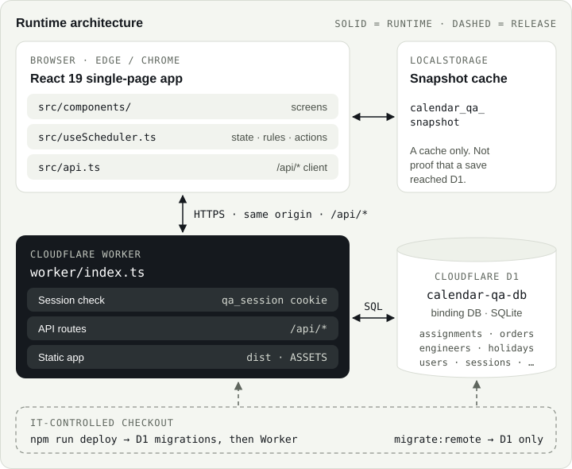

# Developer Guide

How UTAC QA Calendar (QMS-CASS) is built, how to run it locally, and how to change it without breaking the link between screens, rules, API, and database. Production operation (ownership, releases, recovery, security review) is in the [IT Handover](it-handover.md).

> [!CAUTION]
> `npm run deploy` and `npm run migrate:remote` change the live Worker and database. Work against local D1, and run production commands only with IT and QA data-owner approval.

## 1. Architecture

A React 19 and TypeScript single-page app, built by Vite. One Cloudflare Worker serves the built files and the `/api/*` API. Shared data lives in Cloudflare D1 (SQLite).



| Part | Where | Job |
|---|---|---|
| Screens | `src/components/` | Render views and call callbacks from the view model |
| State hub | `src/useScheduler.ts` | State, navigation, filters, validation, create/edit/delete, and the view model (`VM`) |
| Domain rules | `src/types.ts`, `src/holidays.ts`, `src/utils/` | Types, normalization, required fields, status, day rules, metrics, dropdown options |
| API client | `src/api.ts`, `src/utils/authClient.ts` | Same-origin calls to `/api/*`; sign-in and session |
| Worker | `worker/index.ts` | Session checks, API routing, D1 SQL, static asset fallback |
| Schema | `migrations/*.sql` | Ordered D1 migrations; the schema's source of truth |
| Config | `wrangler.toml` | Worker name, `dist` asset binding, D1 binding |

## 2. Run locally

### 2.1 Install

Use a Node.js and npm version compatible with `package-lock.json`, then from the repository root:

```bash
npm ci
```

### 2.2 Frontend only

```bash
npm run dev
```

Vite on `http://localhost:5173`. Good for layout and component work. It does **not** run the Worker or D1; sign-in and data use a browser-local development store that is disabled in production builds. Create a local account through **Sign up**.

### 2.3 Worker with local D1

1. Apply migrations to the local database:

   ```bash
   npm run migrate:local
   ```

2. To test sign-up, create an untracked `.dev.vars` file in the repository root:

   ```dotenv
   REGISTRATION_CODE=any-local-test-value
   ```

3. Build and start the Worker:

   ```bash
   npm run dev:worker
   ```

   Wrangler prints the local URL.

> [!WARNING]
> Never put a production registration code, Cloudflare token, or real customer data in `.dev.vars`, source, logs, or committed screenshots. Never point local development at the production D1 database.

### 2.4 Scripts

| Command | What it does |
|---|---|
| `npm run dev` | Vite dev server, frontend only |
| `npm run dev:worker` | Build, then `wrangler dev` with local D1 |
| `npm run build` | Type-check (`tsc -b`) and bundle with Vite |
| `npm run lint` | `oxlint` |
| `npm run preview` | Preview the production build |
| `npm run migrate:local` | Apply migrations to local D1 |
| `npm run migrate:remote` | Apply migrations to the D1 database in `wrangler.toml` (production) |
| `npm run deploy` | Build and `wrangler deploy`; does not apply migrations |
| `npm test` | Regression test for Customer vs Internal Audit classification |
| `npm run docs` | Rebuild the HTML documentation from these Markdown files |
| `npm run docs:screenshots` | Recapture the doc screenshots from the running dev app |

## 3. How the app starts

1. `src/main.tsx` mounts `<App />`; `src/App.tsx` calls `useScheduler()` and shows Login or the app.
2. `initialState()` in `src/data.ts` loads defaults and the browser snapshot (`calendar_qa_snapshot` in `localStorage`). The month and year come from `getCurrentCalendarDefaults(new Date())`.
3. `useScheduler()` restores the session through `authClient.getSession()` (`GET /api/auth/session`, HttpOnly cookie checked against D1).
4. With a valid session it calls `api.fetchState()` (`GET /api/state`). The Worker reads engineers, plants, orders, assignments, comments, activity, options, and holidays in parallel.
5. The client normalizes the records (`normalizeAssignment`, `normalizeSite`, …) and refreshes the snapshot. From here D1 is the source of truth; the snapshot is only a cache.

If the screen is empty, check which mode you are in (Vite only or Worker + D1), whether you are signed in, and what `/api/auth/session` and `/api/state` return in DevTools.

## 4. Data model

### 4.1 D1 tables

| Table | Key | Holds |
|---|---|---|
| `assignments` | `id` | One row per appointment day: `audit_type` (`customer` / `internal`), site, customer, purpose, audit fields, results, timestamps. Links to `engineers.id` (`eng`) and `orders.id` (`order_id`). |
| `orders` | `id` | Customer, product, and order data shared by assignments |
| `engineers` | `id` | QMS Hosts: role, department, sub-departments |
| `comments` | `id` | Day notes; `assignment_id` links to `assignments` |
| `plants` / `active_plants` | `id` / `plant_id` | Site master data and its active flag |
| `options` | `(category, value)` | Dropdown values and site-color metadata |
| `custom_holidays` | `date` | Holiday, shutdown, no-customer-audit, and working-day rules, with locked sites |
| `activity` | `id` | History entries: action, entity, date, note, timestamp |
| `users` | `id` | Username, password hash and salt, display name, role |
| `sessions` | `token_hash` | Server sessions (logical link to `users`; no foreign key) |

Read the migrations in numeric order from `0001_init.sql`. Never edit a migration that may already be applied; add the next number.

### 4.2 Multi-day appointments

An appointment that spans several days is several `assignments` rows, one per weekday, linked by `seriesId` / `groupId`. Every edit or delete must handle "this day only" versus "the whole series". Audit results are stored per site in `results` and normalized by `normalizeAuditResults()`; they are shared across the series.

## 5. API

All routes are same-origin under `/api/`. The Worker rejects cross-origin requests (Origin and `Sec-Fetch-Site` checks). Everything except sign-in, sign-up, and password reset requires a valid session.

| Route | Methods | Purpose |
|---|---|---|
| `auth/session` | `GET` | Current session |
| `auth/login` | `POST` | Sign in |
| `auth/register` | `POST` | Sign up; needs `REGISTRATION_CODE` |
| `auth/reset-password` | `POST` | Change password; revokes the account's sessions |
| `auth/logout` | `POST` | Revoke the current session |
| `state` | `GET` | Everything the app needs at startup |
| `assignments` · `assignments/:id` | `GET` `POST` · `PUT` `DELETE` | Appointment days |
| `orders` · `orders/:id` | `GET` `POST` · `PUT` `DELETE` | Orders |
| `engineers` · `engineers/:id` | `GET` `POST` · `PUT` `DELETE` | QMS Hosts |
| `plants` · `plants/:id` · `plants/:id/toggle` | `GET` `POST` · `DELETE` · `POST` | Sites and their active flag |
| `comments` · `comments/:id` | `POST` · `DELETE` | Day notes |
| `activity` | `POST` | History entries |
| `options` · `options/reorder` | `POST` `DELETE` · `PUT` | Dropdown values and their order |
| `holidays` · `holidays/:date` · `holidays/reset` | `GET` `POST` `DELETE` · `DELETE` · `POST` | Day rules, bulk delete, reset a year |

Sessions use the HttpOnly `qa_session` cookie (`SameSite=Lax`): 12 hours, or 30 days with **Remember me**. The constants are at the top of `worker/index.ts`.

## 6. Business rules

Each rule has one home in code. Change it there, not in a component.

| Rule | Where |
|---|---|
| Seven sites `UTL1` `UTL2` `UTL2A` `UTL2B` `UTL3` `UTL3A` `UTL3T`; legacy values normalized | `normalizeSite()` / `normalizeSites()` in `src/types.ts`; `MASTER_PLANT_SITES` in `src/utils/auditOptionsHelper.ts` |
| Customer vs Internal Audit: stored in `audit_type` (migration `0020`). Without it, decided from content: customer fields → CS, area / audit category → IA. Never from `site2`, `auditor2`, `department2`: those are compatibility copies on every row. | `isInternalAssignment()` in `src/types.ts`; covered by `npm test` |
| CS needs 8 fields, IA needs 5, both need a valid date range | `getMissingFields()` and `isAppointmentFormIncomplete()` in `src/types.ts` |
| Status: Incomplete → Updated → New → Pending Result → Complete, 7-day windows | `resolveAuditStatus()` and `STATUS_COLOR_MAP` in `src/types.ts` |
| Card fill and border from status; left strip from site color | `getApptCardColors()` in `src/useScheduler.ts`; `initialSiteColors` in `src/data.ts` |
| Public Holiday blocks CS and IA; No Customer Audits blocks CS; Shutdown Plant blocks CS and IA at locked sites; Working Day overrides | `src/holidays.ts`; enforced in `submitCreate()` / `submitEdit()` |
| Dropdown suggestions come from appointments in use, except Site (fixed list) | `getActiveDropdownOptions()` in `src/utils/auditOptionsHelper.ts` |
| Consecutive weekdays with the same customer, site, and purpose count as one audit | `calculateUnifiedAuditMetrics()` / `calculateAuditStats()` in `src/utils/auditMetricsHelper.ts` |
| Card subtitle: "purpose - host", or whichever exists, or "Unassigned" | `formatCardSubtitle()` in `src/types.ts` |
| Multi-value fields stored and shown joined with ` / `; single legacy values stay readable | Form fields and normalizers in `src/types.ts` |

## 7. Making changes

### 7.1 Change a screen

1. Find the component that renders it from `src/App.tsx`.
2. Trace its props back to the `VM` returned by `useScheduler()`.
3. Put markup and interaction in the component, state and actions in the hook, shared rules in the domain helpers.
4. Check wide and narrow layouts, loading, empty, and error states, and keyboard focus.

### 7.2 Add a field to appointments

Change the whole path, top to bottom:

1. Types and meaning: `Assignment`, `CreateDraft`, `EditDraft` in `src/types.ts`.
2. Defaults and hydration: `src/data.ts`, `src/useScheduler.ts`.
3. Form control: `AppointmentFormFields.tsx`, for CS and IA, in create and edit.
4. Validation and normalization in the shared helpers; decide whether the field affects the red status.
5. Serialization in `src/api.ts` and `worker/index.ts`.
6. A new migration, `migrations/0021_<name>.sql` (use the next free number), tested on local D1 with existing data.
7. Cards and details, filters, Table, Summary and exports, History, as relevant.
8. The user and developer guides.

Do not add a form field without its API and database path. Do not break old rows where the field is empty.

### 7.3 Add an API route

1. Define request and response types and add the client method in `src/api.ts`.
2. Add the route in `handleApi()` in `worker/index.ts`; check method, payload, and errors.
3. Bind every request value with `DB.prepare(...).bind(...)`. Never build SQL from strings.
4. Remember that `admin` is not enforced server-side yet (see the [IT Handover](it-handover.md#4-security-findings)). Add an explicit check if the route needs one.

### 7.4 Change status colors or rules

Edit `resolveAuditStatus()` and `STATUS_COLOR_MAP` in `src/types.ts`, and `getApptCardColors()` for fills. Keep the site strip as the site color, never the status color. Check the sidebar legend, Schedule, Table, compact cards, and these guides.

### 7.5 Change holiday rules

Touch all four layers: the Manage UI (`HolidaysPanel.tsx`), `src/holidays.ts`, validation in `submitCreate()` / `submitEdit()`, and the `custom_holidays` routes in the Worker. Changing a cell's color alone does not change what can be booked.

### 7.6 Change an Excel export

Exports live in `TableView.tsx` (`handleExportExcel`) and `SummaryDashboard.tsx` (`handleExportVisitsExcel`, `handleExportFindingsExcel`). They load `xlsx-js-style` on demand and build the file in the browser. Check that the export follows the current filters, year, sites, and column order, then open the file.

### 7.7 Add a site

1. Add the code to `MASTER_PLANT_SITES` in `src/utils/auditOptionsHelper.ts` and `initialSiteCodeOptions` in `src/data.ts`.
2. Add its color to `initialSiteColors` in `src/data.ts`.
3. Add it to `CANONICAL_SITE_ORDER` in `src/components/SummaryDashboard.tsx`.
4. Check `normalizeSite()` and the Worker's site ordering, then run `npm run build`.

## 8. Check your work

Before review:

```bash
npm test          # audit-type classification regression test
npm run lint
npm run build
```

Then test by hand on Worker + local D1, for what you touched:

- sign-in, refresh, sign-out (if auth changed);
- create, edit, delete for both CS and IA, including multi-day and one-day-of-series;
- required fields, red drafts, and holiday rules;
- QMS Hosts, filters, Schedule and Table agreeing, Summary, History, exports;
- no errors in DevTools; data still there after reload.

In the pull request, list the changed files, affected rules, any migration, how you tested, and risks. Never attach secrets or real customer data.

## 9. Migrations and release

1. Number the migration after the latest committed one and name it clearly.
2. Write it to work with existing rows; note whether it can be undone.
3. Apply locally with `npm run migrate:local` and check reads and writes before and after.
4. Get code review and QA data-owner approval.
5. Production migration and deployment are separate steps run by IT. Follow the [release runbook](it-handover.md#5-release-and-database-runbook).

There is no staging environment in `wrangler.toml`. Local is not staging, and production D1 is never a test database.

## 10. Troubleshooting

| Symptom | Check |
|---|---|
| App opens but shows no or odd data | Vite only (`npm run dev`) or Worker (`npm run dev:worker`)? Vite does not use D1. |
| API returns 401 | Session cookie, expiry, and that app and API share one origin |
| Saved data gone after reload | The save warning, the Network response, Worker logs, local D1. The optimistic UI is not proof of a write. |
| Dropdown missing a value, or showing an old one | An appointment still uses (or no longer uses) it; see `getActiveDropdownOptions()` |
| Build fails | Read the first `npm run build` error; check types, `VM`, and API payloads agree |
| Migration fails | Local schema and migration history; add a new migration instead of editing one |
| API works but the page does not load | `npm run build`, the `dist/` folder, `[assets]` and `ASSETS` in `wrangler.toml` |

## 11. Security notes

Read the [security findings](it-handover.md#4-security-findings) before widening access. In short:

- `admin` / `user` is a label, not a server-side permission. Do not assume Manage routes are admin-only.
- `calendar_qa_snapshot` keeps schedule data in `localStorage` after sign-out.
- Sign-up uses one shared `REGISTRATION_CODE`; passwords are salted SHA-256 with a 4-character minimum.
- Never log credentials, cookies, session tokens, registration codes, or unneeded customer data.

## 12. Code map

| To understand or change | Start with |
|---|---|
| App shell and navigation | `src/App.tsx`, `src/components/Header.tsx` |
| Startup, sign-in, hydration | `src/data.ts`, `src/useScheduler.ts`, `src/utils/authClient.ts` |
| Create, edit, delete | `AppointmentFormFields.tsx`, `CreateModal.tsx`, `EditModal.tsx`, `EditScopeModal.tsx`, `src/useScheduler.ts`, `src/api.ts`, `worker/index.ts` |
| Audit results | `AuditResultsModal.tsx`, `normalizeAuditResults()` |
| Holiday rules | `src/holidays.ts`, `HolidaysPanel.tsx`, `src/useScheduler.ts`, `worker/index.ts` |
| Status and site colors | `src/types.ts`, `src/useScheduler.ts`, `Schedule.tsx`, `TableView.tsx` |
| Excel export | `TableView.tsx`, `SummaryDashboard.tsx` |
| Database schema | `migrations/` |
| Production operation | [IT Handover](it-handover.md) |
