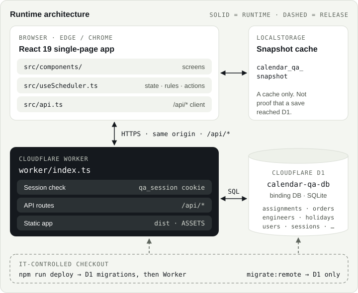

# IT Handover

Everything UTAC IT needs to take over UTAC QA Calendar (QMS-CASS): what to verify, who should own what, the open security findings, and how to release, migrate, recover, and respond to incidents. For how the code works, see the [Developer Guide](developer-guide.md).

> [!IMPORTANT]
> Reviewed against the repository on 27 November 2026. The live Cloudflare account, URL, deployed version, and database have **not** been verified from the repository. Confirm them before treating this as a production runbook.

## 1. System at a glance

- **What it is:** a shared web app for planning Customer Audits (CS) and Internal Audits (IA) across seven UTAC sites (`UTL1`, `UTL2`, `UTL2A`, `UTL2B`, `UTL3`, `UTL3A`, `UTL3T`), replacing spreadsheets.
- **Stack:** React 19, TypeScript, Vite; one Cloudflare Worker serving static assets and the `/api/*` API; Cloudflare D1 (SQLite).
- **Users:** QA Planners, QMS Hosts, QA Admins, and report users on Microsoft Edge or Google Chrome.
- **Data:** audit schedules, customer names, QMS Host names, results, notes, user accounts, and sessions, all in D1. A copy of schedule data is cached in each browser's `localStorage`.

## 2. Configuration to verify

These values come from the repository. Confirm each one in the company's Cloudflare and GitHub accounts.

| Item | Repository value | Notes |
|---|---|---|
| Worker name | `utac-qa-calendar` | `wrangler.toml` |
| Worker entry | `worker/index.ts` | Handles `/api/*` and serves the built app |
| Static assets | `dist`, binding `ASSETS` | Produced by `npm run build` |
| D1 binding | `DB` → `calendar-qa-db` | Database ID `11c524c4-b02e-4d38-840e-ee98294f2118` |
| Compatibility date | `2025-04-01` | |
| Secret | `REGISTRATION_CODE` | Gates sign-up. Set with `npx wrangler secret put REGISTRATION_CODE`; never store its value in Git, tickets, or documents. |
| Session lifetime | 12 hours; 30 days with Remember me | Constants in `worker/index.ts` |
| Source | GitHub remote `origin` | Ownership not confirmed |

**Pending schema change:** migration `0020_assignment_audit_type.sql` adds and backfills `assignments.audit_type`. The next `npm run deploy` applies it automatically (see [5.2](#52-d1-schema-migration)). Until it is applied, the app still classifies audits correctly from their content.

**Not declared in the repository:** a staging environment, custom domain, Cloudflare account ID, CI/CD workflow, or monitoring alerts. That does not prove they do not exist; check the dashboards. A Git push alone does not deploy anything; deployment is `npm run deploy`.

## 3. Ownership and takeover

### 3.1 Proposed owners

Replace each role with a named person and escalation contact during the formal handover.

| Area | Proposed owner | Responsibilities |
|---|---|---|
| Cloudflare account and Worker | UTAC IT Cloud / Platform Operations | Account ownership, least-privilege access, Worker settings, deploy control, domain and routes, account recovery |
| D1 and data protection | IT Data / Platform Operations with the QA data owner | Migration approval, backup and restore policy, access, retention, recovery exercises, export decisions |
| QA process and data quality | QA / QMS process owner | Audit definitions, required fields, statuses, QMS Host roster, holiday rules, user acceptance |
| Source code and releases | Named IT application maintainer with a QA change approver | Repository access, code review, release process, change log, defect triage |
| Identity and security | UTAC IT Identity / Security | Registration policy, admin lifecycle, authentication review, incident response, any SSO / MFA / role-based access work |

### 3.2 Takeover checklist

1. Assign a Cloudflare account owner and at least two company-controlled administrators. Remove individual-only ownership and review user and token access.
2. Confirm the production Worker, URL or custom domain, D1 database, deployed version, Cloudflare account, and GitHub repository ownership. Record them in the company's service register, not in a public document.
3. Confirm whether `REGISTRATION_CODE` is set, who can rotate it, and whether self-registration should stay on.
4. Create IT-owned secrets and API access. Do not reuse a developer's personal Cloudflare credentials.
5. Review the [security findings](#4-security-findings) with IT Security and the QA data owner; assign an owner and decision to each.
6. Name the release approver, rollback decision-maker, support contact, data classification, retention, RPO / RTO, and escalation path.
7. Check D1 recovery coverage on the current Cloudflare plan and rehearse a recovery outside production.
8. Agree what proves a release succeeded: lint and build, sign-in and sign-out, create / edit / delete, Excel download, D1 persistence, and a clean Worker error log.

## 4. Security findings

Decide on each of these before broad production use.

| # | Finding | Risk | Suggested decision |
|---|---|---|---|
| 1 | `admin` / `user` is not an authorization boundary. The header shows a role, but every signed-in user can open Manage, and the Worker checks only for a valid session. | Any account can change master data and holiday rules. | Add and test server-side role checks, or accept the risk in writing. |
| 2 | Sign-up uses one shared `REGISTRATION_CODE`. The first account in an empty database becomes `admin`; later ones are `user`. Migration `0019` promotes the earliest account if no admin exists. There is no screen to manage admins or disable leavers. | Anyone holding the code can create an account; leavers keep access. | Agree an account lifecycle and code-rotation process, or move to company SSO. |
| 3 | Passwords are hashed with salted SHA-256 and need only 4 characters. No SSO or MFA. | Weak passwords; fast hash. | IT Security to approve, or require stronger hashing, password policy, and SSO / MFA. |
| 4 | `calendar_qa_snapshot` in `localStorage` holds appointments, customers, QMS Hosts, and notes. Sign-out revokes the session but leaves this cache. | Data stays on shared or lost devices. | Apply managed-device policy; decide whether the app should clear or minimize the cache on sign-out. |
| 5 | History (the activity log) is stored only in each browser's `localStorage`. It is not written to D1, is not shared between users, and is lost when site data is cleared. The `activity` table's metadata columns (migration `0011`) exist but are not used for it. | There is no server-side audit trail of who changed what. | Decide whether a shared audit log is required; if so, persist History entries to D1. |
| 6 | The remembered UI profile in the browser is not the session. Access always depends on the HttpOnly cookie and the D1 session; an expired session is not extended by the profile. | Low; noted to avoid confusion. | None required. |

Other controls already in place: sessions are random tokens stored only as hashes in D1 and sent in an HttpOnly, `SameSite=Lax` cookie; changing a password revokes all of that account's sessions; the Worker rejects cross-origin requests; all SQL uses bound parameters.

## 5. Release and database runbook

The repository has one Wrangler configuration and no staging environment. Run production commands only from an IT-controlled checkout after confirming the target account and database.

### 5.1 Code release

1. Review the approved commit and confirm the branch and production target.
2. Install exact dependencies: `npm ci`.
3. Run `npm run lint` and `npm run build`; fix any failure before continuing.
4. In the Cloudflare dashboard, check the current deployed version and Worker logs. Confirm bindings and secrets exist without printing secret values.
5. If the release contains a new file in `migrations/`, complete the checks in [5.2](#52-d1-schema-migration) first.
6. Deploy: `npm run deploy`. It builds, applies any pending D1 migrations (Wrangler lists them and asks you to confirm, and takes a backup), then deploys the Worker. If a migration fails, Wrangler rolls that migration back and the code is **not** deployed.
7. Smoke-check: sign in, the current month's Schedule loads, create and edit an appointment, a holiday rule blocks as expected, Table filters and exports, History shows the change. Check Worker errors.
8. Record the commit, deploy time, operator, outcome, migrations applied, and change reference.

### 5.2 D1 schema migration

Migrations run automatically as part of `npm run deploy`, just before the new code goes live. Wrangler applies only migrations that have not run yet, so a release without a new migration changes nothing in the database. Before a release that **does** contain one:

1. Read the new SQL in `migrations/` and judge rollback impact. Never release an unreviewed destructive migration.
2. Check it works with the Worker that is live now, because the database changes a moment before the new code deploys. Adding tables or columns is safe. Dropping or renaming a column the live code still uses must wait for a later release.
3. See what will run: `npx wrangler d1 migrations list calendar-qa-db --remote`.
4. Get QA data-owner approval and follow the company backup and change process.
5. Release with `npm run deploy` (5.1). Confirm the migration list when Wrangler asks. In a non-interactive shell or CI there is no prompt; the migrations apply directly.
6. Afterwards, re-run the list command; it should report nothing pending.

To apply migrations without deploying code (for example, to run a large backfill on its own), use `npm run migrate:remote`.

### 5.3 Rollback and recovery

- Rolling back Worker code and restoring D1 data are separate actions. A code rollback does not undo a migration or bring back deleted rows. Check code and schema compatibility before rolling back either.
- A Worker version rollback takes effect immediately. Confirm the target version and approval, and record it.
- To recover data: limit writes, find the right point in time, keep evidence, and follow the company-approved D1 recovery process, tested outside production where possible. Cloudflare currently documents D1 Time Travel windows of 7 days (Workers Free) and 30 days (Workers Paid); confirm the plan before relying on them.
- Any recovery that touches production records needs QA data-owner approval and an incident or change record.

## 6. Monitoring and incidents

1. In the Cloudflare dashboard, check the `utac-qa-calendar` Worker logs for exceptions and failing API calls. From an authorized checkout, `npx wrangler tail` streams live logs.
2. Classify the failure: static assets, Worker API or authentication, D1 query or migration, or client connectivity. A 401 points to the session; a 5xx to the Worker or database.
3. For missing or stale data, check Worker errors, D1 persistence, and the app's save warning before asking users to repeat edits.
4. Record the time and time zone, affected user and site, request path (without credentials), deployed version, and impact. Never record passwords, cookies, registration codes, or session tokens.
5. Escalate suspected data loss or unauthorized access to UTAC IT Security and the QA data owner under the company incident procedure.

## 7. Handover acceptance

Complete jointly, with an owner and evidence for each line.

- [ ] Company ownership of the source repository and Cloudflare account confirmed.
- [ ] Live Worker, URL or domain, D1 database, secrets, and deployed version recorded in an approved internal location.
- [ ] Production migration state inspected; database recovery rehearsed outside production.
- [ ] Registration, admin lifecycle, and role-enforcement findings reviewed by IT Security and QA.
- [ ] Browser cache and data-retention finding addressed or formally accepted by the data owner.
- [ ] Release, rollback, monitoring, support, RPO / RTO, and escalation owners assigned.
- [ ] QA users have validated the agreed audit workflows and exports.

## References

Cloudflare documentation (check for changes before each operation): [Workers deploy and rollback](https://developers.cloudflare.com/workers/wrangler/commands/workers/) · [D1 migrations](https://developers.cloudflare.com/d1/wrangler-commands/) · [D1 Time Travel and backups](https://developers.cloudflare.com/d1/reference/time-travel/) · [Worker secrets](https://developers.cloudflare.com/workers/configuration/secrets/) · [Worker logs](https://developers.cloudflare.com/workers/observability/logs/) · [Workers roles and permissions](https://developers.cloudflare.com/workers/authorization/workers/)
