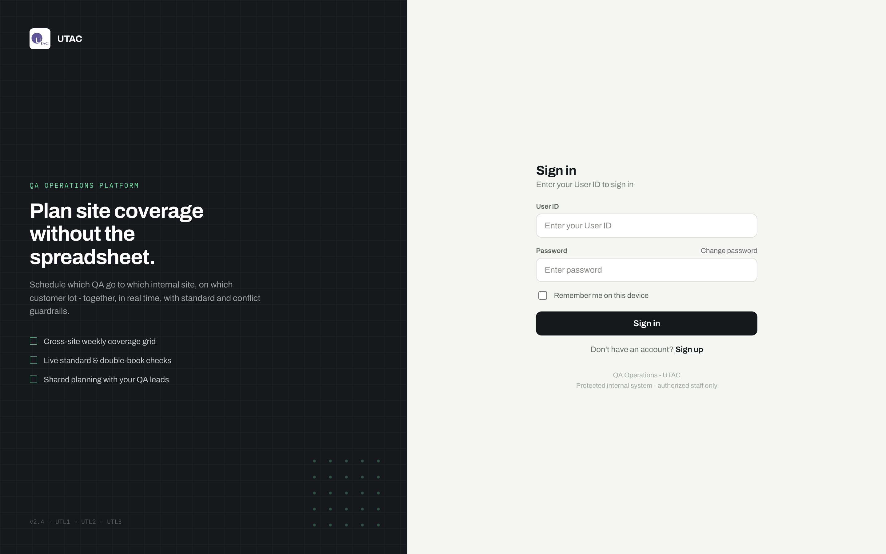
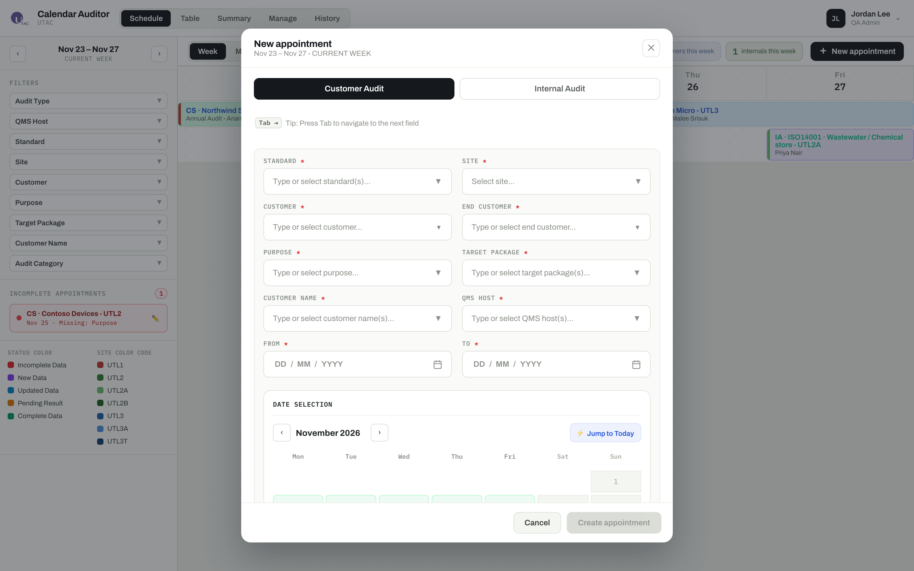
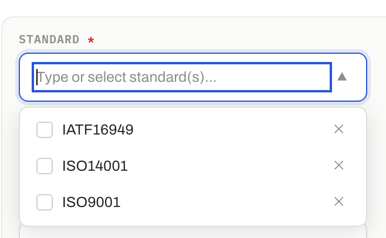

# User Guide

How to plan Customer Audits (CS) and Internal Audits (IA) in UTAC QA Calendar (QMS-CASS), record their results, maintain the data behind them, and report on them. Part one explains how the calendar works. Part two gives step-by-step tasks for each role.

> [!NOTE]
> Roles in this guide describe who usually does a task. The app does not hide menus by role, so follow your team's approval rules before changing shared data.

## 1. Before you start

### 1.1 Browser

Use a current **Microsoft Edge** (UTAC standard) or **Google Chrome** in a standard window.

- Avoid InPrivate or Incognito windows; the sign-in does not survive closing them.
- Do not set the browser to clear cookies and site data on exit, or you will be signed out every time.
- Allow downloads from the app so Excel (`.xlsx`) exports can be saved.

### 1.2 Sign in

1. Enter your **User ID** and **Password**, then select **Sign in**. The app opens **Schedule** on the current month.
2. Tick **Remember me on this device** to stay signed in for up to 30 days. Without it, the session ends after 12 hours.
3. New account: choose **Sign up** and enter the registration code your administrator gave you, a User ID, and a password. Sign-up does not work without a valid code.
4. To change your password, choose **Change password** and enter your current password first. Changing it ends every session for your account, so sign in again with the new password.

### 1.3 Find your way around

The top bar has five pages: **Schedule** (calendar), **Table** (searchable records), **Summary** (yearly totals), **Manage** (QMS Hosts, options, holidays), and **History** (change log). Open the menu under your name for **Your profile** and **Sign out**.

")

> [!WARNING]
> On a shared computer, always choose **Sign out** when you finish. Do not use shared or public computers for sensitive audit records.

## 2. How the calendar works

### 2.1 Sites

The calendar covers seven sites. Each has a color used for the strip on the left edge of its cards. Administrators can change these colors; the app shows the current ones under **Site Color Code** in the Schedule sidebar.

| Site | Default color |
|---|---|
| `UTL1` | `#c0392b` |
| `UTL2` | `#2e7d32` |
| `UTL2A` | `#66bb6a` |
| `UTL2B` | `#1b5e20` |
| `UTL3` | `#1e5fa8` |
| `UTL3A` | `#4a90d9` |
| `UTL3T` | `#123f73` |

### 2.2 Appointment status

A card's background color shows its status. The app works the status out for you; you never set it by hand.

| Color | Status | Meaning | What to do |
|---|---|---|---|
| 🔴 Red | Incomplete Data | A required field or the date range is missing | Open the card and fill the fields it lists |
| 🔵 Blue | Updated Data | Complete, and edited in the last 7 days | Check that the change is correct |
| 🟣 Purple | New Data | Complete, and created in the last 7 days | Nothing; it is a new booking |
| 🟡 Amber | Pending Result | The audit date has arrived but no results are recorded | Record the results |
| 🟢 Green | Complete Data | Complete, with nothing pending | Nothing |

The app checks in the order shown: red first, then blue, purple, amber, and finally green. So an appointment created this week and then edited shows blue, not purple.

")

### 2.3 Day rules

Day cells show whether a date accepts audits. Always read the label on the cell.

| Day cell | Rule | Customer Audit (CS) | Internal Audit (IA) |
|---|---|---|---|
| White | Normal working day | Allowed | Allowed |
| Gray | `Public Holiday` | Blocked | Blocked |
| Blue | `No Customer Audits` | Blocked | Allowed |
| Blue | `Shutdown Plant` | Blocked | Allowed only at sites the rule does not lock |

Weekends are skipped: a multi-day range books weekdays only. A `Working Day` override makes a built-in holiday bookable again. Holiday rules never move or delete appointments that already exist.

### 2.4 Required fields

| Audit type | Required fields |
|---|---|
| Customer Audit (CS) | Standard, Site, Customer, End Customer, Purpose, Target Package, Customer Name, QMS Host, and a valid date range |
| Internal Audit (IA) | Standard, Site, Audit Category, Area, QMS Host, and a valid date range |

You can save an appointment before every field is filled. It stays red, and the sidebar lists it under **Incomplete Appointments** until you complete it.

## 3. QA Planner: plan audits

### 3.1 Create a Customer Audit (CS)

1. Open **Schedule**, choose **Month**, and use the arrows to reach the month you are planning.
2. Check the day cells. `Public Holiday`, `No Customer Audits`, and `Shutdown Plant` all block CS.
3. Select **New appointment**, or click a date, then choose **Customer Audit**.
4. Fill the eight CS fields and set **From** and **To**. The end date cannot be before the start date.
5. Select **Create appointment**.
6. Check that the card appears on the right days and site. If it is red, open it and complete the missing fields.

Fields such as Customer and QMS Host are searchable lists. Type to filter, click to select one or more values, and select **×** to remove one.

### 3.2 Create an Internal Audit (IA)

1. Pick a normal day, a `No Customer Audits` day, or a `Shutdown Plant` day whose rule does not lock your site.
2. Select **New appointment** or click the date, then choose **Internal Audit**.
3. Fill the five IA fields and the date range. In **Area**, select several values or type a new one; multiple areas are shown joined with ` / `.
4. Select **Create appointment** and check the card.

### 3.3 Find, edit, or delete an appointment

1. Narrow the calendar with the sidebar filters: **Audit Type**, **QMS Host**, **Standard**, **Site**, **Customer**, **Purpose**, **Target Package**, **Customer Name**, **Audit Category**. **Clear all** removes them. Filters change only what you see.
2. Click a card to open it. Use the pencil to edit or the bin to delete.
3. For a multi-day appointment, the app asks whether the change applies to one day or the whole series. Read the prompt before you confirm.
4. Select **Save changes**, then check the day, site, and status.

")

## 4. QMS Host: review and record results

### 4.1 Review your audits

1. Open **Schedule** and filter by your name under **QMS Host** and by your **Site**.
2. Check the date, site, audit type, Standard, and Customer (CS) or Area (IA).
3. If something is wrong, tell the QA Planner rather than changing it without approval.
4. Before an IA on a `Shutdown Plant` day, confirm your site is not locked.

### 4.2 Record results

1. Open the appointment and select the **Audit Results** icon.
2. For each site, enter the counts for **Major**, **Minor**, **OFI**, **OBS**, and **Findings**.
3. Check the numbers and the site, then select **Save Results**. Results apply to the whole multi-day series.
4. Use **NOTES** in the day details for handover remarks.
5. If the card stays amber, something is still outstanding; follow it up.

> [!TIP]
> If results disappear after a refresh, read any warning message and tell the QA Planner or administrator before entering them again. Repeating the entry can create duplicates.

## 5. QA Admin: maintain hosts, options, and holidays

### 5.1 QMS Hosts

1. Open **Manage → QMS Host**.
2. Filter by **Site**, **Standard**, or **Department** to find the right person.
3. Select **New QMS Host** to add someone, or open a row to edit name, role, site, and department. Drag rows to change the order.
4. Before removing a host, check that no planned audit still needs them.

")

### 5.2 Form options

1. Open **Manage → Options** and choose a group such as Standard, Customer, Purpose, Target Package, or Audit Category.
2. Add, remove (**✕**), or drag values to reorder them. Check spelling and duplicates first.
3. Removing a value only affects future choices; existing appointments keep the value they were saved with.

### 5.3 Holidays and restrictions

1. Open **Manage → Holidays**. Change the year with the arrows, or type a four-digit year and press Enter.
2. Click a date, or select **Add Date Range Rule**, and choose the rule: `Public Holiday`, `No Customer Audits`, or `Shutdown Plant`.
3. For `Shutdown Plant`, tick the sites to lock under **Affected Sites (Shutdown)**. None are ticked by default; use **Select All** if every site is affected.
4. Enter a name or note, check the dates, rule, and sites, then select **Save Status**.
5. Select the **Public Holidays** card to see the year's holidays in date order. Use **Reset to Normal Day** to clear a date's rule.

")

> [!NOTE]
> There is no Excel or CSV holiday import. Add rules on the calendar or with **Add Date Range Rule**.

## 6. Reports: search, export, and history

### 6.1 Table and Excel export

1. Open **Table**. Search by text or filter by **Audit Type**, **Sites**, **Standards**, **Categories**, **Packages**, **Customers**, **QMS Hosts**, and **From / To**.
2. Click a column heading to sort; click again to reverse. **Reset filters** clears everything.
3. Check the result count, then select the Excel button to download the filtered rows as `.xlsx`.
4. Open the file and check the headers, row count, and a sample site before you share it.

")

### 6.2 Summary

Open **Summary** for the year's totals: audits, customer visits by site and month, and findings by site. Choose the year with the arrows or the year box. **Export to Excel** downloads the visits or findings tables for the selected year.

")

### 6.3 History

Open **History** to see what changed. Filter by text, **Action**, **Entity**, and date range; times are shown in your local time. It records appointment changes, result changes, QMS Host and option changes, and holiday rules. If something looks wrong, note the time and record and contact the QA Admin.

> [!IMPORTANT]
> History is currently kept in each browser, not on the server. It shows only changes made in that browser, colleagues do not see it, and clearing browser data erases it. Do not rely on it as the official audit trail.

")

> [!WARNING]
> Exported workbooks can contain customer names and audit details. Store and share them under UTAC's data-handling rules.

## 7. End-of-day checklist

- **QA Planner:** no red cards left; new and updated bookings have the right dates and hosts.
- **QMS Host:** results recorded for finished audits; pending ones have an owner and follow-up date.
- **QA Admin:** master-data and holiday requests checked against the right sites and dates.
- **Report user:** filters and period confirmed before sharing any export.
- **Everyone:** sign out on shared computers.

## 8. Troubleshooting

| Problem | What to check |
|---|---|
| An appointment is missing | Month or year, view (Week / Month / Year), and active filters. Try **Clear all**. |
| A card is red | Open it; it lists the missing fields. |
| Cannot book a CS | `Public Holiday`, `No Customer Audits`, or `Shutdown Plant` on any day in the range. |
| Cannot book an IA | `Public Holiday`, or your site is locked by `Shutdown Plant`. |
| A change disappeared after refresh | Read the warning and check your connection; report it before retrying. |
| Export does not match | Filters, date range, year, and result count. |
| Signed out after every restart | InPrivate/Incognito, or the browser clears site data on exit. |
| Cannot sign in or sign up | Check User ID and password; ask the administrator for a registration code or account help. |

When you report a problem, include the page, the time, the site, and what you did. Remove customer details from screenshots.
