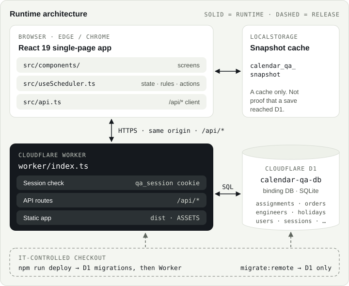

# คู่มือนักพัฒนา

อธิบายว่า UTAC QA Calendar (QMS-CASS) สร้างอย่างไร รันในเครื่องอย่างไร และแก้ไขอย่างไรโดยไม่ทำให้การเชื่อมต่อระหว่างหน้าจอ กฎธุรกิจ API และฐานข้อมูลเสียหาย เรื่องการดูแลระบบจริง (เจ้าของระบบ การ release การกู้คืน และการทบทวนความปลอดภัย) อยู่ใน [IT Handover](../en/it-handover.md) (ภาษาอังกฤษ)

> [!CAUTION]
> `npm run deploy` และ `npm run migrate:remote` เปลี่ยน Worker และฐานข้อมูลจริง ให้ทำงานกับ local D1 และรันคำสั่ง production เฉพาะเมื่อได้รับอนุมัติจาก IT และเจ้าของข้อมูล QA

## 1. สถาปัตยกรรม

แอปเป็น single-page app ด้วย React 19 และ TypeScript ที่ build ด้วย Vite มี Cloudflare Worker ตัวเดียวทำหน้าที่ให้บริการไฟล์ที่ build แล้วและ API `/api/*` ข้อมูลที่ใช้ร่วมกันเก็บใน Cloudflare D1 (SQLite)



| ส่วน | ตำแหน่ง | หน้าที่ |
|---|---|---|
| หน้าจอ | `src/components/` | แสดงผลและเรียก callback จาก view model |
| ศูนย์กลาง state | `src/useScheduler.ts` | state, navigation, filter, validation, สร้าง/แก้/ลบ และ view model (`VM`) |
| กฎธุรกิจ | `src/types.ts`, `src/holidays.ts`, `src/utils/` | types, normalization, ฟิลด์บังคับ, สถานะ, กฎวัน, metrics, ตัวเลือก dropdown |
| API client | `src/api.ts`, `src/utils/authClient.ts` | เรียก `/api/*` แบบ same-origin, sign-in และ session |
| Worker | `worker/index.ts` | ตรวจ session, routing API, SQL กับ D1, ส่งไฟล์ static |
| Schema | `migrations/*.sql` | migration ของ D1 ตามลำดับ เป็นแหล่งอ้างอิง schema |
| Config | `wrangler.toml` | ชื่อ Worker, asset binding `dist`, D1 binding |

## 2. รันในเครื่อง

### 2.1 ติดตั้ง

ใช้ Node.js และ npm ที่เข้ากันได้กับ `package-lock.json` แล้วรันจาก root ของ repository:

```bash
npm ci
```

### 2.2 เฉพาะ frontend

```bash
npm run dev
```

Vite ที่ `http://localhost:5173` เหมาะกับงาน layout และ component **ไม่ได้**รัน Worker หรือ D1 การ sign-in และข้อมูลใช้ที่เก็บในเบราว์เซอร์สำหรับพัฒนาเท่านั้น (ปิดใน production build) ให้สร้างบัญชีในเครื่องผ่าน **Sign up**

### 2.3 Worker พร้อม local D1

1. apply migration กับฐานข้อมูลในเครื่อง:

   ```bash
   npm run migrate:local
   ```

2. หากต้องทดสอบการสมัคร ให้สร้างไฟล์ `.dev.vars` ที่ root (ไฟล์นี้ไม่ถูก commit):

   ```dotenv
   REGISTRATION_CODE=ค่าทดสอบในเครื่อง
   ```

3. build และเริ่ม Worker:

   ```bash
   npm run dev:worker
   ```

   Wrangler จะแสดง URL ในเครื่อง

> [!WARNING]
> ห้ามใส่ registration code ของ production, Cloudflare token หรือข้อมูลลูกค้าจริงใน `.dev.vars`, source code, log หรือภาพหน้าจอที่ commit และห้ามชี้การพัฒนาในเครื่องไปที่ D1 ของ production

### 2.4 คำสั่ง

| คำสั่ง | ทำอะไร |
|---|---|
| `npm run dev` | Vite dev server เฉพาะ frontend |
| `npm run dev:worker` | build แล้ว `wrangler dev` กับ local D1 |
| `npm run build` | ตรวจ type (`tsc -b`) และ bundle ด้วย Vite |
| `npm run lint` | `oxlint` |
| `npm run preview` | ดูตัวอย่าง production build |
| `npm run migrate:local` | apply migration กับ local D1 |
| `npm run migrate:remote` | apply migration กับ D1 ใน `wrangler.toml` (production) |
| `npm run deploy` | build และ `wrangler deploy` ไม่ apply migration |
| `npm test` | regression test การแยกประเภท Customer / Internal Audit |
| `npm run docs` | สร้างเอกสาร HTML ใหม่จากไฟล์ Markdown เหล่านี้ |
| `npm run docs:screenshots` | ถ่ายภาพหน้าจอสำหรับเอกสารใหม่จากแอปที่รันอยู่ |

## 3. แอปเริ่มทำงานอย่างไร

1. `src/main.tsx` mount `<App />` แล้ว `src/App.tsx` เรียก `useScheduler()` และแสดง Login หรือแอป
2. `initialState()` ใน `src/data.ts` โหลดค่าเริ่มต้นและ browser snapshot (`calendar_qa_snapshot` ใน `localStorage`) เดือนและปีมาจาก `getCurrentCalendarDefaults(new Date())`
3. `useScheduler()` คืนค่า session ผ่าน `authClient.getSession()` (`GET /api/auth/session` ตรวจ HttpOnly cookie กับ D1)
4. เมื่อ session ใช้ได้ จึงเรียก `api.fetchState()` (`GET /api/state`) Worker อ่าน engineers, plants, orders, assignments, comments, activity, options และ holidays พร้อมกัน
5. client normalize ข้อมูล (`normalizeAssignment`, `normalizeSite` ฯลฯ) และอัปเดต snapshot จากจุดนี้ D1 เป็นแหล่งข้อมูลหลัก snapshot เป็นเพียง cache

หากหน้าจอว่าง ให้ตรวจว่าอยู่ในโหมดใด (Vite อย่างเดียว หรือ Worker + D1) เข้าสู่ระบบแล้วหรือยัง และดูใน DevTools ว่า `/api/auth/session` และ `/api/state` ตอบอะไร

## 4. โครงสร้างข้อมูล

### 4.1 ตารางใน D1

| ตาราง | คีย์ | เก็บอะไร |
|---|---|---|
| `assignments` | `id` | หนึ่งแถวต่อหนึ่งวันของนัดหมาย: `audit_type` (`customer` / `internal`) ไซต์ ลูกค้า purpose ฟิลด์การตรวจ ผลตรวจ timestamps เชื่อม `engineers.id` (`eng`) และ `orders.id` (`order_id`) |
| `orders` | `id` | ข้อมูลลูกค้า สินค้า และ order ที่ใช้ร่วมกัน |
| `engineers` | `id` | QMS Host: บทบาท แผนก แผนกย่อย |
| `comments` | `id` | บันทึกของวัน เชื่อม `assignments` ด้วย `assignment_id` |
| `plants` / `active_plants` | `id` / `plant_id` | ข้อมูลหลักของไซต์และสถานะเปิดใช้ |
| `options` | `(category, value)` | ค่าของ dropdown และข้อมูลสีไซต์ |
| `custom_holidays` | `date` | กฎวันหยุด shutdown no-customer-audit และ working-day พร้อมไซต์ที่ล็อก |
| `activity` | `id` | ประวัติ: action, entity, วันที่, หมายเหตุ, timestamp |
| `users` | `id` | ชื่อผู้ใช้ hash และ salt ของรหัสผ่าน ชื่อที่แสดง บทบาท |
| `sessions` | `token_hash` | session ฝั่งเซิร์ฟเวอร์ (เชื่อม `users` เชิงตรรกะ ไม่มี foreign key) |

อ่าน migration ตามลำดับเลขตั้งแต่ `0001_init.sql` ห้ามแก้ migration ที่อาจ apply ไปแล้ว ให้เพิ่มไฟล์หมายเลขถัดไป

### 4.2 นัดหมายหลายวัน

นัดหมายหลายวันคือหลายแถวใน `assignments` หนึ่งแถวต่อหนึ่งวันทำงาน เชื่อมกันด้วย `seriesId` / `groupId` การแก้หรือลบทุกครั้งต้องรองรับทั้ง "เฉพาะวันนี้" และ "ทั้งชุด" ผลตรวจเก็บแยกตามไซต์ใน `results` และ normalize ด้วย `normalizeAuditResults()` โดยใช้ร่วมกันทั้งชุด

## 5. API

ทุก route อยู่ใต้ `/api/` แบบ same-origin Worker ปฏิเสธ request ข้าม origin (ตรวจ Origin และ `Sec-Fetch-Site`) ทุก route ยกเว้น sign-in, sign-up และเปลี่ยนรหัสผ่าน ต้องมี session ที่ใช้ได้

| Route | Methods | หน้าที่ |
|---|---|---|
| `auth/session` | `GET` | session ปัจจุบัน |
| `auth/login` | `POST` | เข้าสู่ระบบ |
| `auth/register` | `POST` | สมัคร ต้องใช้ `REGISTRATION_CODE` |
| `auth/reset-password` | `POST` | เปลี่ยนรหัสผ่าน และยกเลิกทุก session ของบัญชี |
| `auth/logout` | `POST` | ยกเลิก session ปัจจุบัน |
| `state` | `GET` | ข้อมูลทั้งหมดที่แอปใช้ตอนเริ่ม |
| `assignments` · `assignments/:id` | `GET` `POST` · `PUT` `DELETE` | วันของนัดหมาย |
| `orders` · `orders/:id` | `GET` `POST` · `PUT` `DELETE` | Orders |
| `engineers` · `engineers/:id` | `GET` `POST` · `PUT` `DELETE` | QMS Host |
| `plants` · `plants/:id` · `plants/:id/toggle` | `GET` `POST` · `DELETE` · `POST` | ไซต์และสถานะเปิดใช้ |
| `comments` · `comments/:id` | `POST` · `DELETE` | บันทึกของวัน |
| `activity` | `POST` | รายการประวัติ |
| `options` · `options/reorder` | `POST` `DELETE` · `PUT` | ค่าของ dropdown และลำดับ |
| `holidays` · `holidays/:date` · `holidays/reset` | `GET` `POST` `DELETE` · `DELETE` · `POST` | กฎวัน ลบหลายรายการ รีเซ็ตทั้งปี |

session ใช้ cookie `qa_session` แบบ HttpOnly (`SameSite=Lax`): 12 ชั่วโมง หรือ 30 วันเมื่อเลือก **Remember me** ค่าคงที่อยู่ต้นไฟล์ `worker/index.ts`

## 6. กฎธุรกิจ

กฎแต่ละข้อมีที่อยู่เดียวในโค้ด ให้แก้ที่นั่น ไม่ใช่ใน component

| กฎ | ตำแหน่ง |
|---|---|
| 7 ไซต์ `UTL1` `UTL2` `UTL2A` `UTL2B` `UTL3` `UTL3A` `UTL3T` และ normalize ค่าเก่า | `normalizeSite()` / `normalizeSites()` ใน `src/types.ts`; `MASTER_PLANT_SITES` ใน `src/utils/auditOptionsHelper.ts` |
| ประเภท Customer หรือ Internal Audit: เก็บใน `audit_type` (migration `0020`) หากไม่มีค่า ให้ตัดสินจากเนื้อหา: มีฟิลด์ลูกค้า → CS, มี area / audit category → IA ห้ามใช้ `site2`, `auditor2`, `department2` เพราะเป็นค่าสำเนาที่มีในทุกแถว | `isInternalAssignment()` ใน `src/types.ts` ทดสอบด้วย `npm test` |
| CS ต้องมี 8 ฟิลด์ IA ต้องมี 5 ฟิลด์ และทั้งคู่ต้องมีช่วงวันที่ที่ถูกต้อง | `getMissingFields()` และ `isAppointmentFormIncomplete()` ใน `src/types.ts` |
| สถานะ: Incomplete → Updated → New → Pending Result → Complete ด้วยกรอบเวลา 7 วัน | `resolveAuditStatus()` และ `STATUS_COLOR_MAP` ใน `src/types.ts` |
| สีพื้นและขอบการ์ดมาจากสถานะ แถบซ้ายมาจากสีไซต์ | `getApptCardColors()` ใน `src/useScheduler.ts`; `initialSiteColors` ใน `src/data.ts` |
| Public Holiday ปิด CS และ IA; No Customer Audits ปิด CS; Shutdown Plant ปิด CS และ IA ที่ไซต์ที่ล็อก; Working Day ยกเว้นวันหยุด | `src/holidays.ts` บังคับใช้ใน `submitCreate()` / `submitEdit()` |
| ตัวเลือก dropdown มาจากนัดหมายที่ใช้งานอยู่ ยกเว้น Site (รายการคงที่) | `getActiveDropdownOptions()` ใน `src/utils/auditOptionsHelper.ts` |
| วันทำงานต่อเนื่องที่ลูกค้า ไซต์ และ purpose เดียวกัน นับเป็นการตรวจ 1 ครั้ง | `calculateUnifiedAuditMetrics()` / `calculateAuditStats()` ใน `src/utils/auditMetricsHelper.ts` |
| ข้อความรองของการ์ด: "purpose - host" หรือค่าที่มี หรือ "Unassigned" | `formatCardSubtitle()` ใน `src/types.ts` |
| ฟิลด์หลายค่าเก็บและแสดงโดยคั่นด้วย ` / ` และยังอ่านค่าเดี่ยวแบบเก่าได้ | ฟิลด์ในฟอร์มและ normalizer ใน `src/types.ts` |

## 7. การแก้ไขระบบ

### 7.1 แก้หน้าจอ

1. หา component ที่ render หน้านั้นจาก `src/App.tsx`
2. ตาม props กลับไปที่ `VM` ที่ `useScheduler()` คืนค่า
3. markup และ interaction อยู่ใน component, state และ action อยู่ใน hook, กฎร่วมอยู่ใน domain helper
4. ตรวจหน้าจอกว้างและแคบ สถานะ loading, empty, error และ keyboard focus

### 7.2 เพิ่มฟิลด์ในนัดหมาย

แก้ให้ครบทั้งเส้นทาง จากบนลงล่าง:

1. type และความหมาย: `Assignment`, `CreateDraft`, `EditDraft` ใน `src/types.ts`
2. ค่าเริ่มต้นและ hydration: `src/data.ts`, `src/useScheduler.ts`
3. control ในฟอร์ม: `AppointmentFormFields.tsx` ทั้ง CS และ IA ทั้งสร้างและแก้ไข
4. validation และ normalization ใน helper ร่วม และตัดสินว่าฟิลด์มีผลต่อสถานะสีแดงหรือไม่
5. serialization ใน `src/api.ts` และ `worker/index.ts`
6. migration ใหม่ `migrations/0021_<name>.sql` (ใช้หมายเลขถัดไปที่ว่าง) ทดสอบกับ local D1 และข้อมูลเดิม
7. การ์ดและรายละเอียด ตัวกรอง Table Summary และ export History ตามที่เกี่ยวข้อง
8. คู่มือผู้ใช้และคู่มือนักพัฒนา

อย่าเพิ่มฟิลด์ในฟอร์มโดยไม่มีเส้นทาง API และฐานข้อมูล และอย่าทำให้แถวเก่าที่ฟิลด์ว่างอ่านไม่ได้

### 7.3 เพิ่ม API route

1. กำหนด type ของ request และ response แล้วเพิ่ม method ใน `src/api.ts`
2. เพิ่ม route ใน `handleApi()` ใน `worker/index.ts` ตรวจ method, payload และกรณีผิดพลาด
3. bind ค่าจาก request ทุกค่าด้วย `DB.prepare(...).bind(...)` ห้ามต่อ SQL จาก string
4. จำไว้ว่า `admin` ยังไม่ถูกบังคับฝั่งเซิร์ฟเวอร์ (ดู [IT Handover](../en/it-handover.md#4-security-findings)) ให้เพิ่มการตรวจเองหาก route ต้องใช้

### 7.4 เปลี่ยนสีหรือกฎสถานะ

แก้ `resolveAuditStatus()` และ `STATUS_COLOR_MAP` ใน `src/types.ts` และ `getApptCardColors()` สำหรับสีพื้น แถบซ้ายต้องเป็นสีไซต์เสมอ ไม่ใช่สีสถานะ ตรวจ legend ในแถบด้านข้าง Schedule Table การ์ดแบบย่อ และคู่มือเหล่านี้

### 7.5 เปลี่ยนกฎวันหยุด

ต้องแก้ทั้ง 4 ชั้น: หน้า Manage (`HolidaysPanel.tsx`), `src/holidays.ts`, validation ใน `submitCreate()` / `submitEdit()` และ route `custom_holidays` ใน Worker การเปลี่ยนสีช่องวันอย่างเดียวไม่ได้เปลี่ยนสิ่งที่จองได้

### 7.6 เปลี่ยนการส่งออก Excel

export อยู่ใน `TableView.tsx` (`handleExportExcel`) และ `SummaryDashboard.tsx` (`handleExportVisitsExcel`, `handleExportFindingsExcel`) โหลด `xlsx-js-style` เมื่อใช้งานและสร้างไฟล์ในเบราว์เซอร์ ตรวจว่า export ตามตัวกรอง ปี ไซต์ และลำดับคอลัมน์ปัจจุบัน แล้วเปิดไฟล์จริง

### 7.7 เพิ่มไซต์

1. เพิ่มรหัสใน `MASTER_PLANT_SITES` ใน `src/utils/auditOptionsHelper.ts` และ `initialSiteCodeOptions` ใน `src/data.ts`
2. เพิ่มสีใน `initialSiteColors` ใน `src/data.ts`
3. เพิ่มใน `CANONICAL_SITE_ORDER` ใน `src/components/SummaryDashboard.tsx`
4. ตรวจ `normalizeSite()` และลำดับไซต์ใน Worker แล้วรัน `npm run build`

## 8. ตรวจงานก่อนส่ง

ก่อนส่ง review:

```bash
npm test          # ทดสอบการแยกประเภท Customer / Internal Audit
npm run lint
npm run build
```

จากนั้นทดสอบด้วยมือบน Worker + local D1 ตามส่วนที่แก้:

- sign-in, refresh, sign-out (หากแก้ auth)
- สร้าง แก้ ลบ ทั้ง CS และ IA รวมถึงหลายวันและแก้เฉพาะวันในชุด
- ฟิลด์บังคับ ร่างสีแดง และกฎวันหยุด
- QMS Host ตัวกรอง Schedule กับ Table ตรงกัน Summary History และ export
- ไม่มี error ใน DevTools และข้อมูลยังอยู่หลัง reload

ใน pull request ให้ระบุไฟล์ที่เปลี่ยน กฎที่ได้รับผล migration (ถ้ามี) วิธีทดสอบ และความเสี่ยง ห้ามแนบ secret หรือข้อมูลลูกค้าจริง

## 9. Migration และ release

1. ตั้งหมายเลข migration ต่อจากไฟล์ล่าสุดที่ commit และตั้งชื่อให้สื่อความหมาย
2. เขียนให้ใช้กับแถวเดิมได้ และระบุว่าย้อนกลับได้หรือไม่
3. apply ในเครื่องด้วย `npm run migrate:local` และตรวจการอ่าน/เขียนก่อนและหลัง
4. ขอ code review และอนุมัติจากเจ้าของข้อมูล QA
5. migration และ deploy บน production เป็นคนละขั้นตอนที่ IT เป็นผู้ทำ ดู [release runbook](../en/it-handover.md#5-release-and-database-runbook)

`wrangler.toml` ไม่มี staging environment ในเครื่องไม่ใช่ staging และห้ามใช้ D1 ของ production ทดสอบ

## 10. แก้ปัญหาที่พบบ่อย

| อาการ | ตรวจ |
|---|---|
| เปิดแอปได้แต่ไม่มีข้อมูลหรือข้อมูลแปลก | ใช้ Vite อย่างเดียว (`npm run dev`) หรือ Worker (`npm run dev:worker`)? Vite ไม่ใช้ D1 |
| API ตอบ 401 | session cookie, เวลาหมดอายุ และแอปกับ API ใช้ origin เดียวกัน |
| ข้อมูลหายหลัง reload | ข้อความเตือนการบันทึก, Network response, Worker log, local D1 การแสดงผลแบบ optimistic ไม่ได้ยืนยันว่าเขียนสำเร็จ |
| dropdown ไม่มีค่า หรือยังมีค่าเก่า | มี (หรือไม่มี) นัดหมายที่ใช้ค่านั้นอยู่ ดู `getActiveDropdownOptions()` |
| build ไม่ผ่าน | อ่าน error แรกจาก `npm run build` ตรวจ types, `VM` และ API payload ให้ตรงกัน |
| migration ล้มเหลว | schema และประวัติ migration ในเครื่อง ให้เพิ่ม migration ใหม่แทนการแก้ไฟล์เดิม |
| API ทำงานแต่หน้าเว็บไม่ขึ้น | `npm run build`, โฟลเดอร์ `dist/`, `[assets]` และ `ASSETS` ใน `wrangler.toml` |

## 11. ข้อควรระวังด้านความปลอดภัย

อ่าน [ข้อค้นพบด้านความปลอดภัย](../en/it-handover.md#4-security-findings) ก่อนเปิดให้ใช้งานกว้างขึ้น โดยสรุป:

- `admin` / `user` เป็นเพียงป้ายชื่อ ไม่ใช่สิทธิ์ฝั่งเซิร์ฟเวอร์ อย่าสมมติว่า route ของ Manage ใช้ได้เฉพาะ admin
- `calendar_qa_snapshot` เก็บข้อมูลตารางใน `localStorage` และไม่ถูกลบเมื่อ sign-out
- การสมัครใช้ `REGISTRATION_CODE` ร่วมกันค่าเดียว รหัสผ่านใช้ salted SHA-256 และยาวขั้นต่ำ 4 ตัวอักษร
- ห้าม log credential, cookie, session token, registration code หรือข้อมูลลูกค้าที่ไม่จำเป็น

## 12. แผนที่อ่านโค้ด

| ต้องการเข้าใจหรือแก้ | เริ่มที่ |
|---|---|
| โครงแอปและ navigation | `src/App.tsx`, `src/components/Header.tsx` |
| การเริ่มต้น sign-in และ hydration | `src/data.ts`, `src/useScheduler.ts`, `src/utils/authClient.ts` |
| สร้าง แก้ ลบ | `AppointmentFormFields.tsx`, `CreateModal.tsx`, `EditModal.tsx`, `EditScopeModal.tsx`, `src/useScheduler.ts`, `src/api.ts`, `worker/index.ts` |
| ผลตรวจ | `AuditResultsModal.tsx`, `normalizeAuditResults()` |
| กฎวันหยุด | `src/holidays.ts`, `HolidaysPanel.tsx`, `src/useScheduler.ts`, `worker/index.ts` |
| สีสถานะและสีไซต์ | `src/types.ts`, `src/useScheduler.ts`, `Schedule.tsx`, `TableView.tsx` |
| Excel export | `TableView.tsx`, `SummaryDashboard.tsx` |
| Database schema | `migrations/` |
| การดูแลระบบจริง | [IT Handover](../en/it-handover.md) |
