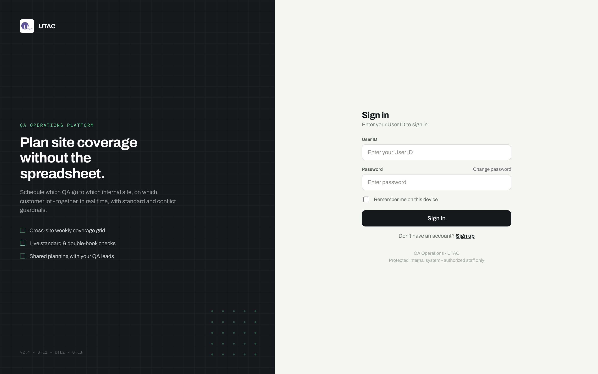
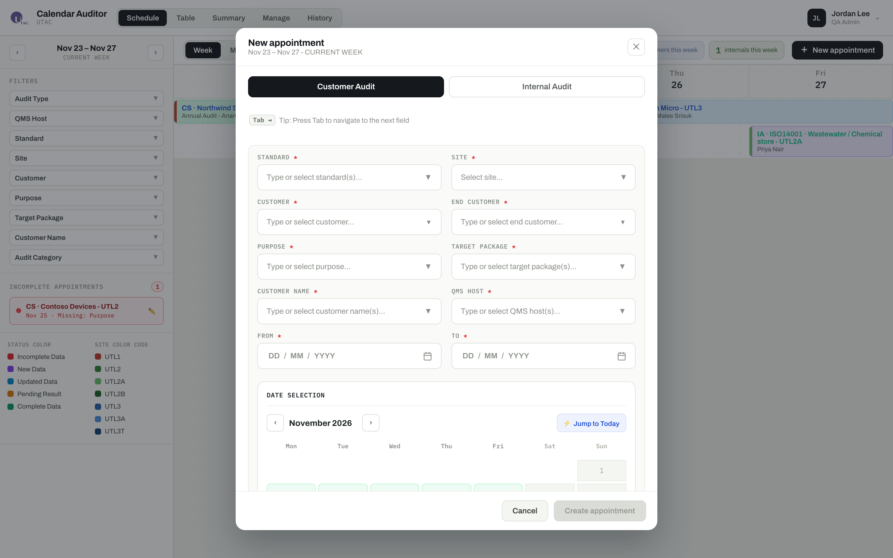
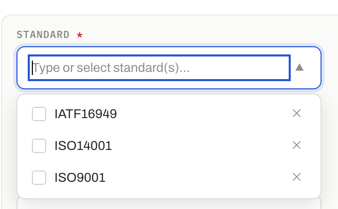

# คู่มือผู้ใช้

วิธีวางแผน Customer Audit (CS) และ Internal Audit (IA) ใน UTAC QA Calendar (QMS-CASS) บันทึกผลตรวจ ดูแลข้อมูลหลัก และจัดทำรายงาน ส่วนแรกอธิบายว่าปฏิทินทำงานอย่างไร ส่วนที่สองเป็นขั้นตอนการทำงานแยกตามบทบาท

> [!NOTE]
> บทบาทในคู่มือนี้บอกว่าใครมักทำงานใด ระบบไม่ได้ซ่อนเมนูตามบทบาท ก่อนแก้ข้อมูลที่ใช้ร่วมกัน ให้ทำตามขั้นตอนอนุมัติของหน่วยงาน

## 1. ก่อนเริ่มใช้งาน

### 1.1 เบราว์เซอร์

ใช้ **Microsoft Edge** (เบราว์เซอร์มาตรฐานของ UTAC) หรือ **Google Chrome** เวอร์ชันปัจจุบันในหน้าต่างปกติ

- หลีกเลี่ยงหน้าต่าง InPrivate หรือ Incognito เพราะการเข้าสู่ระบบจะหายเมื่อปิดหน้าต่าง
- อย่าตั้งค่าให้เบราว์เซอร์ล้าง cookies และข้อมูลเว็บไซต์เมื่อปิด มิฉะนั้นจะต้องเข้าสู่ระบบใหม่ทุกครั้ง
- อนุญาตการดาวน์โหลดจากแอป เพื่อบันทึกไฟล์ Excel (`.xlsx`) ได้

### 1.2 เข้าสู่ระบบ

1. กรอก **User ID** และ **Password** แล้วเลือก **Sign in** ระบบจะเปิดหน้า **Schedule** ของเดือนปัจจุบัน
2. เลือก **Remember me on this device** เพื่อคงการเข้าสู่ระบบได้นานสูงสุด 30 วัน หากไม่เลือก เซสชันจะหมดอายุภายใน 12 ชั่วโมง
3. บัญชีใหม่: เลือก **Sign up** แล้วกรอกรหัสลงทะเบียน (registration code) ที่ผู้ดูแลระบบให้ พร้อม User ID และรหัสผ่าน หากไม่มีรหัสที่ถูกต้องจะสมัครไม่ได้
4. เปลี่ยนรหัสผ่าน: เลือก **Change password** และกรอกรหัสผ่านปัจจุบันก่อน เมื่อเปลี่ยนแล้วทุกเซสชันของบัญชีจะสิ้นสุด ให้เข้าสู่ระบบใหม่ด้วยรหัสใหม่

### 1.3 เมนูหลัก

แถบด้านบนมี 5 หน้า: **Schedule** (ปฏิทิน), **Table** (ค้นหารายการ), **Summary** (สรุปรายปี), **Manage** (QMS Host ตัวเลือก และวันหยุด) และ **History** (ประวัติการเปลี่ยนแปลง) เปิดเมนูใต้ชื่อผู้ใช้เพื่อไปที่ **Your profile** หรือ **Sign out**

")

> [!WARNING]
> หากใช้เครื่องร่วมกัน ให้เลือก **Sign out** ทุกครั้งที่ใช้งานเสร็จ และไม่ควรใช้เครื่องสาธารณะหรือเครื่องที่ใช้ร่วมกันกับข้อมูลการตรวจที่เป็นความลับ

## 2. ปฏิทินทำงานอย่างไร

### 2.1 ไซต์

ปฏิทินครอบคลุม 7 ไซต์ แต่ละไซต์มีสีประจำที่ใช้กับแถบด้านซ้ายของการ์ด ผู้ดูแลระบบเปลี่ยนสีได้ สีปัจจุบันดูได้ที่ **Site Color Code** ในแถบด้านข้างของหน้า Schedule

| ไซต์ | สีเริ่มต้น |
|---|---|
| `UTL1` | `#c0392b` |
| `UTL2` | `#2e7d32` |
| `UTL2A` | `#66bb6a` |
| `UTL2B` | `#1b5e20` |
| `UTL3` | `#1e5fa8` |
| `UTL3A` | `#4a90d9` |
| `UTL3T` | `#123f73` |

### 2.2 สถานะของนัดหมาย

สีพื้นของการ์ดบอกสถานะ ระบบคำนวณสถานะให้เอง ผู้ใช้ไม่ต้องตั้งค่า

| สี | สถานะ | ความหมาย | สิ่งที่ต้องทำ |
|---|---|---|---|
| 🔴 แดง | Incomplete Data | ฟิลด์ที่จำเป็นหรือช่วงวันที่ยังไม่ครบ | เปิดการ์ดและกรอกฟิลด์ที่ระบบแจ้ง |
| 🔵 น้ำเงิน | Updated Data | ข้อมูลครบ และมีการแก้ไขภายใน 7 วัน | ตรวจว่าการแก้ไขถูกต้อง |
| 🟣 ม่วง | New Data | ข้อมูลครบ และสร้างภายใน 7 วัน | ไม่ต้องทำอะไร เป็นนัดหมายใหม่ |
| 🟡 อำพัน | Pending Result | ถึงวันตรวจแล้วแต่ยังไม่บันทึกผล | บันทึกผลตรวจ |
| 🟢 เขียว | Complete Data | ข้อมูลครบและไม่มีงานค้าง | ไม่ต้องทำอะไร |

ระบบตรวจตามลำดับในตาราง: แดงก่อน แล้วน้ำเงิน ม่วง อำพัน และสุดท้ายเขียว ดังนั้นนัดหมายที่สร้างในสัปดาห์นี้แล้วถูกแก้ไข จะแสดงเป็นน้ำเงิน ไม่ใช่ม่วง

")

### 2.3 กฎของวัน

ช่องวันบอกว่าวันนั้นรับการนัดหมายได้หรือไม่ ให้อ่านป้ายชื่อบนช่องวันทุกครั้ง

| ช่องวัน | กฎ | Customer Audit (CS) | Internal Audit (IA) |
|---|---|---|---|
| ขาว | วันทำงานปกติ | อนุญาต | อนุญาต |
| เทา | `Public Holiday` | ไม่อนุญาต | ไม่อนุญาต |
| น้ำเงิน | `No Customer Audits` | ไม่อนุญาต | อนุญาต |
| น้ำเงิน | `Shutdown Plant` | ไม่อนุญาต | อนุญาตเฉพาะไซต์ที่กฎไม่ได้ล็อก |

ระบบข้ามวันเสาร์-อาทิตย์ การนัดหมายหลายวันจะจองเฉพาะวันทำงาน กฎ `Working Day` ใช้เปลี่ยนวันหยุดในระบบให้กลับมาจองได้ กฎวันหยุดไม่ย้ายหรือลบนัดหมายที่มีอยู่แล้ว

### 2.4 ฟิลด์ที่จำเป็น

| ประเภท | ฟิลด์ที่จำเป็น |
|---|---|
| Customer Audit (CS) | Standard, Site, Customer, End Customer, Purpose, Target Package, Customer Name, QMS Host และช่วงวันที่ที่ถูกต้อง |
| Internal Audit (IA) | Standard, Site, Audit Category, Area, QMS Host และช่วงวันที่ที่ถูกต้อง |

บันทึกนัดหมายได้แม้ยังกรอกไม่ครบ การ์ดจะเป็นสีแดง และแสดงในรายการ **Incomplete Appointments** ที่แถบด้านข้างจนกว่าจะกรอกครบ

## 3. QA Planner: วางแผนการตรวจ

### 3.1 สร้าง Customer Audit (CS)

1. เปิด **Schedule** เลือก **Month** แล้วใช้ลูกศรไปยังเดือนที่ต้องวางแผน
2. ตรวจช่องวัน `Public Holiday`, `No Customer Audits` และ `Shutdown Plant` ไม่อนุญาต CS ทั้งหมด
3. เลือก **New appointment** หรือคลิกวันที่ แล้วเลือก **Customer Audit**
4. กรอก 8 ฟิลด์ของ CS และกำหนด **From** และ **To** วันสิ้นสุดต้องไม่อยู่ก่อนวันเริ่ม
5. เลือก **Create appointment**
6. ตรวจว่าการ์ดอยู่ในวันและไซต์ที่ถูกต้อง หากเป็นสีแดง ให้เปิดการ์ดและกรอกฟิลด์ที่ขาด

ฟิลด์อย่าง Customer และ QMS Host เป็นรายการแบบค้นหาได้ พิมพ์เพื่อกรอง คลิกเพื่อเลือกได้หลายค่า และกด **×** เพื่อนำค่าออก

### 3.2 สร้าง Internal Audit (IA)

1. เลือกวันปกติ วัน `No Customer Audits` หรือวัน `Shutdown Plant` ที่กฎไม่ได้ล็อกไซต์ของคุณ
2. เลือก **New appointment** หรือคลิกวันที่ แล้วเลือก **Internal Audit**
3. กรอก 5 ฟิลด์ของ IA และช่วงวันที่ ในช่อง **Area** เลือกได้หลายค่าหรือพิมพ์เพื่อสร้างค่าใหม่ หลายค่าจะแสดงคั่นด้วย ` / `
4. เลือก **Create appointment** แล้วตรวจการ์ด

### 3.3 ค้นหา แก้ไข หรือลบนัดหมาย

1. ใช้ตัวกรองที่แถบด้านข้าง: **Audit Type**, **QMS Host**, **Standard**, **Site**, **Customer**, **Purpose**, **Target Package**, **Customer Name**, **Audit Category** กด **Clear all** เพื่อล้างตัวกรอง ตัวกรองเปลี่ยนเฉพาะสิ่งที่แสดง ไม่ได้แก้ข้อมูล
2. คลิกการ์ดเพื่อเปิด ใช้ไอคอนดินสอเพื่อแก้ไข หรือถังขยะเพื่อลบ
3. นัดหมายหลายวันจะถามว่าให้แก้เฉพาะวันนั้นหรือทั้งชุด อ่านให้ดีก่อนยืนยัน
4. เลือก **Save changes** แล้วตรวจวัน ไซต์ และสถานะอีกครั้ง

")

## 4. QMS Host: ตรวจตารางและบันทึกผล

### 4.1 ตรวจการตรวจที่ได้รับมอบหมาย

1. เปิด **Schedule** แล้วกรองด้วยชื่อของคุณใน **QMS Host** และ **Site**
2. ตรวจวันที่ ไซต์ ประเภทการตรวจ Standard และ Customer (CS) หรือ Area (IA)
3. หากข้อมูลไม่ถูกต้อง ให้แจ้ง QA Planner แทนการแก้เองโดยไม่ได้รับอนุมัติ
4. ก่อนตรวจ IA ในวัน `Shutdown Plant` ให้ยืนยันว่าไซต์ของคุณไม่ถูกล็อก

### 4.2 บันทึกผลตรวจ

1. เปิดนัดหมายแล้วเลือกไอคอน **Audit Results**
2. กรอกจำนวน **Major**, **Minor**, **OFI**, **OBS** และ **Findings** ของแต่ละไซต์
3. ตรวจตัวเลขและไซต์ แล้วเลือก **Save Results** ผลตรวจใช้กับทั้งชุดของนัดหมายหลายวัน
4. ใช้ส่วน **NOTES** ในรายละเอียดของวันเพื่อบันทึกข้อมูลส่งต่อ
5. หากการ์ดยังเป็นสีอำพัน แปลว่ายังมีงานค้าง ให้ติดตามต่อ

> [!TIP]
> หากผลตรวจหายไปหลังรีเฟรช ให้อ่านข้อความแจ้งเตือน และแจ้ง QA Planner หรือผู้ดูแลระบบก่อนบันทึกซ้ำ การบันทึกซ้ำอาจทำให้ข้อมูลซ้ำซ้อน

## 5. QA Admin: ดูแล QMS Host ตัวเลือก และวันหยุด

### 5.1 QMS Host

1. เปิด **Manage → QMS Host**
2. กรองด้วย **Site**, **Standard** หรือ **Department** เพื่อหาคนที่ต้องการ
3. เลือก **New QMS Host** เพื่อเพิ่มคน หรือเปิดรายการเพื่อแก้ชื่อ บทบาท ไซต์ และแผนก ลากรายการเพื่อเปลี่ยนลำดับ
4. ก่อนลบ ให้ตรวจว่าไม่มีการตรวจที่วางแผนไว้ที่ยังต้องใช้คนนั้น

")

### 5.2 ตัวเลือกในแบบฟอร์ม

1. เปิด **Manage → Options** แล้วเลือกกลุ่ม เช่น Standard, Customer, Purpose, Target Package หรือ Audit Category
2. เพิ่ม ลบ (**✕**) หรือลากเพื่อเรียงลำดับ ตรวจตัวสะกดและค่าซ้ำก่อน
3. การลบค่ามีผลกับการเลือกในอนาคตเท่านั้น นัดหมายเดิมยังคงค่าที่บันทึกไว้

### 5.3 วันหยุดและข้อจำกัด

1. เปิด **Manage → Holidays** เปลี่ยนปีด้วยลูกศร หรือพิมพ์ปี 4 หลักแล้วกด Enter
2. คลิกวันที่ หรือเลือก **Add Date Range Rule** แล้วเลือกกฎ: `Public Holiday`, `No Customer Audits` หรือ `Shutdown Plant`
3. สำหรับ `Shutdown Plant` ให้เลือกไซต์ที่ต้องล็อกใน **Affected Sites (Shutdown)** ค่าเริ่มต้นไม่มีไซต์ถูกเลือก ใช้ **Select All** หากกระทบทุกไซต์
4. ใส่ชื่อหรือหมายเหตุ ตรวจวันที่ กฎ และไซต์ แล้วเลือก **Save Status**
5. เลือกการ์ด **Public Holidays** เพื่อดูวันหยุดของปีเรียงตามวันที่ ใช้ **Reset to Normal Day** เพื่อล้างกฎของวันนั้น

")

> [!NOTE]
> ยังไม่มีการนำเข้าวันหยุดจากไฟล์ Excel หรือ CSV ให้เพิ่มกฎบนปฏิทินหรือด้วย **Add Date Range Rule**

## 6. รายงาน: ค้นหา ส่งออก และดูประวัติ

### 6.1 Table และการส่งออก Excel

1. เปิด **Table** ค้นหาด้วยข้อความ หรือกรองด้วย **Audit Type**, **Sites**, **Standards**, **Categories**, **Packages**, **Customers**, **QMS Hosts** และ **From / To**
2. คลิกหัวคอลัมน์เพื่อเรียง คลิกซ้ำเพื่อกลับลำดับ **Reset filters** ล้างเงื่อนไขทั้งหมด
3. ตรวจจำนวนผลลัพธ์ แล้วกดปุ่ม Excel เพื่อดาวน์โหลดแถวที่ผ่านตัวกรองเป็นไฟล์ `.xlsx`
4. เปิดไฟล์ ตรวจหัวคอลัมน์ จำนวนแถว และไซต์ตัวอย่างก่อนส่งต่อ

")

### 6.2 Summary

เปิด **Summary** เพื่อดูยอดรวมของปี: จำนวนการตรวจ การเข้าตรวจของลูกค้าแยกตามไซต์และเดือน และผลตรวจแยกตามไซต์ เลือกปีด้วยลูกศรหรือช่องปี **Export to Excel** ดาวน์โหลดตาราง visits หรือ findings ของปีที่เลือก

")

### 6.3 History

เปิด **History** เพื่อดูว่ามีอะไรเปลี่ยนแปลง กรองด้วยข้อความ **Action**, **Entity** และช่วงวันที่ เวลาแสดงตามเขตเวลาของเครื่อง ระบบบันทึกการเปลี่ยนนัดหมาย ผลตรวจ QMS Host ตัวเลือก และกฎวันหยุด หากพบสิ่งผิดปกติ ให้จดเวลาและรายการ แล้วติดต่อ QA Admin

> [!IMPORTANT]
> ปัจจุบัน History เก็บไว้ในเบราว์เซอร์แต่ละเครื่อง ไม่ได้เก็บบนเซิร์ฟเวอร์ จึงแสดงเฉพาะการเปลี่ยนแปลงที่ทำจากเบราว์เซอร์นั้น เพื่อนร่วมงานจะไม่เห็น และจะหายเมื่อล้างข้อมูลเบราว์เซอร์ อย่าใช้เป็นหลักฐานการตรวจสอบอย่างเป็นทางการ

")

> [!WARNING]
> ไฟล์ที่ส่งออกอาจมีชื่อลูกค้าและรายละเอียดการตรวจ ให้จัดเก็บและส่งต่อตามแนวทางการจัดการข้อมูลของ UTAC

## 7. ตรวจสอบก่อนจบวัน

- **QA Planner:** ไม่มีการ์ดสีแดงค้าง นัดหมายใหม่และที่แก้ไขมีวันที่และผู้รับผิดชอบถูกต้อง
- **QMS Host:** บันทึกผลของการตรวจที่เสร็จแล้ว รายการที่ค้างมีผู้รับผิดชอบและวันติดตาม
- **QA Admin:** ตรวจคำขอแก้ข้อมูลหลักและกฎวันหยุดกับไซต์และวันที่ที่ถูกต้อง
- **ผู้ทำรายงาน:** ยืนยันตัวกรองและช่วงเวลาก่อนส่งไฟล์
- **ทุกคน:** Sign out เมื่อใช้เครื่องร่วมกัน

## 8. แก้ปัญหาเบื้องต้น

| ปัญหา | สิ่งที่ต้องตรวจ |
|---|---|
| ไม่พบนัดหมาย | เดือนหรือปี มุมมอง (Week / Month / Year) และตัวกรอง ลองกด **Clear all** |
| การ์ดเป็นสีแดง | เปิดการ์ด ระบบจะแสดงฟิลด์ที่ขาด |
| จอง CS ไม่ได้ | มี `Public Holiday`, `No Customer Audits` หรือ `Shutdown Plant` ในช่วงวันที่ที่เลือก |
| จอง IA ไม่ได้ | เป็น `Public Holiday` หรือไซต์ของคุณถูกล็อกโดย `Shutdown Plant` |
| ข้อมูลหายหลังรีเฟรช | อ่านข้อความแจ้งเตือนและตรวจการเชื่อมต่อ แจ้งผู้ดูแลก่อนบันทึกซ้ำ |
| ไฟล์ส่งออกไม่ตรง | ตัวกรอง ช่วงวันที่ ปี และจำนวนผลลัพธ์ |
| ต้องเข้าสู่ระบบใหม่ทุกครั้งที่เปิดเบราว์เซอร์ | ใช้ InPrivate/Incognito หรือเบราว์เซอร์ล้างข้อมูลเว็บไซต์เมื่อปิด |
| เข้าสู่ระบบหรือสมัครไม่ได้ | ตรวจ User ID และรหัสผ่าน หรือขอ registration code / ความช่วยเหลือจากผู้ดูแลระบบ |

เมื่อแจ้งปัญหา ให้ระบุหน้า เวลา ไซต์ และขั้นตอนที่ทำ และลบข้อมูลลูกค้าออกจากภาพหน้าจอ
